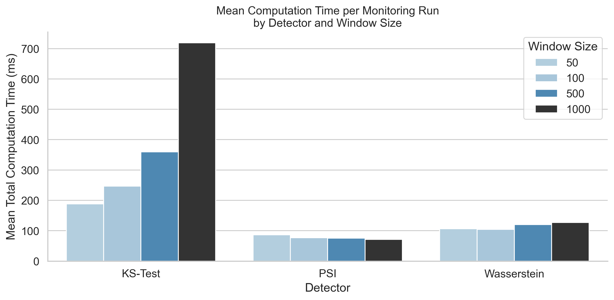
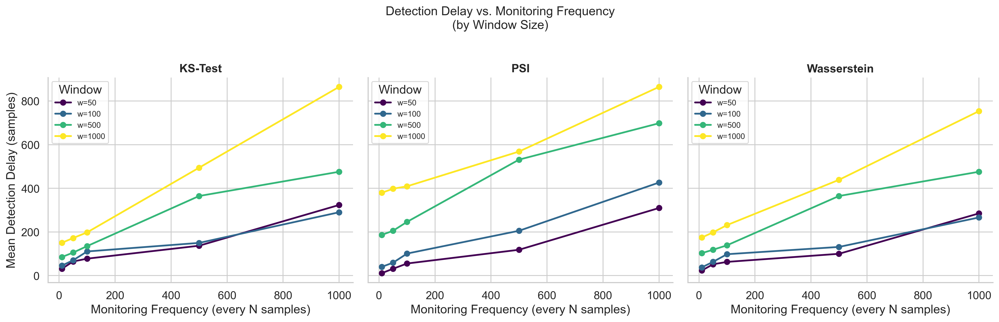
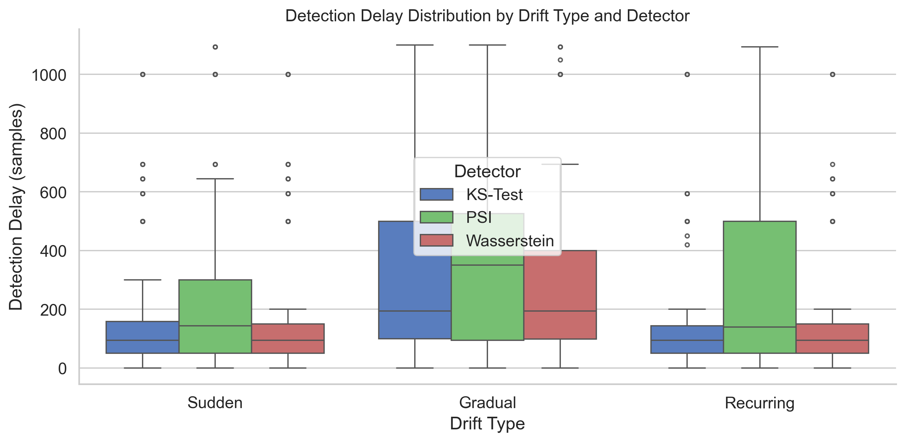
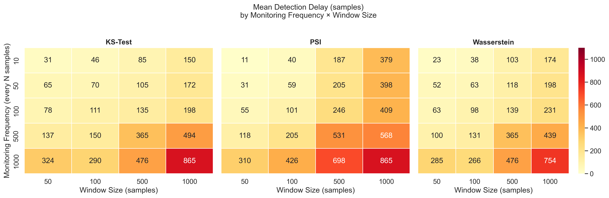
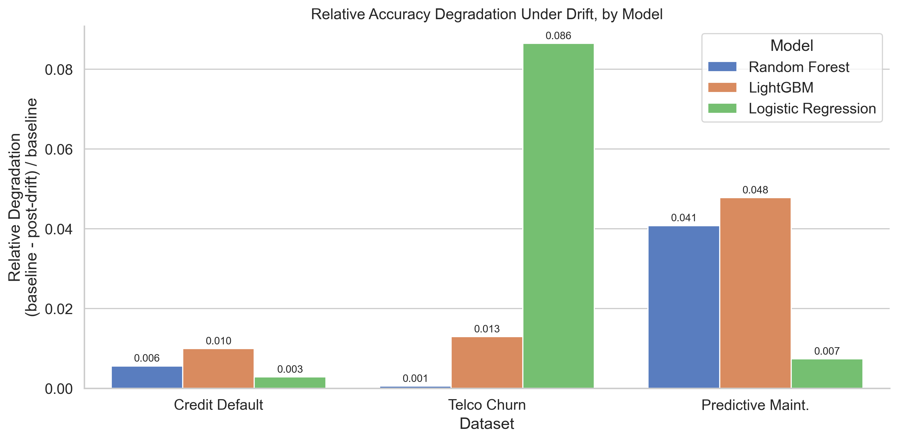

# When Configuration Matters More Than Algorithm

## An Empirical Evaluation of Lightweight Drift Detectors Under Resource Constraints

---

## Table of Contents

- [Chapter 1: Introduction](#chapter-1-introduction)
  - [1.1 Background and Motivation](#11-background-and-motivation)
  - [1.2 Problem Statement](#12-problem-statement)
  - [1.3 Research Questions](#13-research-questions)
  - [1.4 Objectives](#14-objectives)
  - [1.5 Scope and Delimitations](#15-scope-and-delimitations)
  - [1.6 Significance of the Study](#16-significance-of-the-study)
  - [1.7 Thesis Structure](#17-thesis-structure)
- [Chapter 2: Literature Review](#chapter-2-literature-review)
  - [2.1 Introduction to the Chapter](#21-introduction-to-the-chapter)
  - [2.2 Concept Drift: Definitions and Taxonomy](#22-concept-drift-definitions-and-taxonomy)
    - [2.2.1 Formal Definition](#221-formal-definition)
    - [2.2.2 Drift Type Patterns](#222-drift-type-patterns)
  - [2.3 A Framework for Drift Detection](#23-a-framework-for-drift-detection)
    - [2.3.1 The Four-Stage Detection Pipeline](#231-the-four-stage-detection-pipeline)
    - [2.3.2 The Adaptive Learning Cycle](#232-the-adaptive-learning-cycle)
  - [2.4 Supervised Drift Detection Methods](#24-supervised-drift-detection-methods)
    - [2.4.1 Classification of Algorithms](#241-classification-of-algorithms)
    - [2.4.2 The Large-Scale Empirical Comparison](#242-the-large-scale-empirical-comparison)
    - [2.4.3 Supervised Detectors Under Label Constraints](#243-supervised-detectors-under-label-constraints)
  - [2.5 Unsupervised and Distribution-Based Drift Detection](#25-unsupervised-and-distribution-based-drift-detection)
    - [2.5.1 The Unsupervised Detection Paradigm](#251-the-unsupervised-detection-paradigm)
    - [2.5.2 Benchmark Findings from Lukats et al. (2024)](#252-benchmark-findings-from-lukats-et-al-2024)
    - [2.5.3 Neural and Kernel Approaches](#253-neural-and-kernel-approaches)
  - [2.6 Distribution-Based Detection: KS Test, PSI, and Wasserstein Distance](#26-distribution-based-detection-ks-test-psi-and-wasserstein-distance)
    - [2.6.1 The Kolmogorov-Smirnov Test](#261-the-kolmogorov-smirnov-test)
    - [2.6.2 The Population Stability Index](#262-the-population-stability-index)
    - [2.6.3 The Wasserstein Distance](#263-the-wasserstein-distance)
    - [2.6.4 Comparative Properties of the Three Detectors](#264-comparative-properties-of-the-three-detectors)
  - [2.7 Resource Constraints in Machine Learning Monitoring Systems](#27-resource-constraints-in-machine-learning-monitoring-systems)
    - [2.7.1 The Resource-Constrained Deployment Context](#271-the-resource-constrained-deployment-context)
    - [2.7.2 Key Constraint Parameters](#272-key-constraint-parameters)
    - [2.7.3 The Monitoring Frequency-Delay Tradeoff](#273-the-monitoring-frequency-delay-tradeoff)
  - [2.8 Machine Learning Models Under Concept Drift](#28-machine-learning-models-under-concept-drift)
    - [2.8.1 Random Forests](#281-random-forests)
    - [2.8.2 Logistic Regression](#282-logistic-regression)
    - [2.8.3 LightGBM](#283-lightgbm)
    - [2.8.4 The Model Robustness Dimension](#284-the-model-robustness-dimension)
  - [2.9 Evaluation Metrics for Drift Detection](#29-evaluation-metrics-for-drift-detection)
    - [2.9.1 Standard Metrics](#291-standard-metrics)
    - [2.9.2 Statistical Methods for Comparing Conditions](#292-statistical-methods-for-comparing-conditions)
    - [2.9.3 Evaluation Challenges in Real-World Data](#293-evaluation-challenges-in-real-world-data)
  - [2.10 Research Gaps and Positioning of This Study](#210-research-gaps-and-positioning-of-this-study)
    - [2.10.1 Summary of What Is Known](#2101-summary-of-what-is-known)
    - [2.10.2 The Gaps This Study Addresses](#2102-the-gaps-this-study-addresses)
    - [2.10.3 This Study's Contribution to the Literature](#2103-this-studys-contribution-to-the-literature)
  - [2.11 Chapter Summary](#211-chapter-summary)
- [Chapter 3: Methodology](#chapter-3-methodology)
  - [3.1 Research Design](#31-research-design)
  - [3.2 Datasets](#32-datasets)
    - [3.2.1 UCI Default of Credit Card Clients](#321-uci-default-of-credit-card-clients)
    - [3.2.2 IBM Telco Customer Churn](#322-ibm-telco-customer-churn)
    - [3.2.3 AI4I 2020 Predictive Maintenance](#323-ai4i-2020-predictive-maintenance)
    - [3.2.4 Preprocessing and Reference-Stream Split](#324-preprocessing-and-reference-stream-split)
  - [3.3 Drift Detection Methods](#33-drift-detection-methods)
    - [3.3.1 Kolmogorov-Smirnov Test](#331-kolmogorov-smirnov-test)
    - [3.3.2 Population Stability Index](#332-population-stability-index)
    - [3.3.3 Wasserstein Distance](#333-wasserstein-distance)
  - [3.4 Drift Simulation](#34-drift-simulation)
    - [3.4.1 Sudden Drift](#341-sudden-drift)
    - [3.4.2 Gradual Drift](#342-gradual-drift)
    - [3.4.3 Recurring Drift](#343-recurring-drift)
    - [3.4.4 Drift Timing and Magnitude](#344-drift-timing-and-magnitude)
  - [3.5 Machine Learning Models](#35-machine-learning-models)
  - [3.6 Experimental Variables](#36-experimental-variables)
    - [3.6.1 Independent Variables: Resource Constraints](#361-independent-variables-resource-constraints)
    - [3.6.2 Dependent Variables: Detection Performance Metrics](#362-dependent-variables-detection-performance-metrics)
  - [3.7 Experimental Protocol](#37-experimental-protocol)
  - [3.8 Statistical Analysis](#38-statistical-analysis)
    - [3.8.1 Kruskal-Wallis H-Test](#381-kruskal-wallis-h-test)
    - [3.8.2 Pairwise Mann-Whitney U Tests with Bonferroni Correction](#382-pairwise-mann-whitney-u-tests-with-bonferroni-correction)
    - [3.8.3 Effect Size](#383-effect-size)
    - [3.8.4 Spearman Rank Correlation](#384-spearman-rank-correlation)
  - [3.9 Implementation](#39-implementation)
- [Chapter 4: Results](#chapter-4-results)
  - [4.1 Overview](#41-overview)
  - [4.2 Detector Performance (RQ1)](#42-detector-performance-rq1)
    - [4.2.1 Aggregate Performance Summary](#421-aggregate-performance-summary)
    - [4.2.2 Detection Delay: Statistical Evidence](#422-detection-delay-statistical-evidence)
    - [4.2.3 Missed Detections and False Positives](#423-missed-detections-and-false-positives)
    - [4.2.4 Computation Time](#424-computation-time)
  - [4.3 Effect of Drift Type (RQ2)](#43-effect-of-drift-type-rq2)
    - [4.3.1 Detection Delay by Drift Type](#431-detection-delay-by-drift-type)
    - [4.3.2 Accuracy Degradation by Drift Type and Dataset](#432-accuracy-degradation-by-drift-type-and-dataset)
  - [4.4 Effect of Resource Constraints (RQ3)](#44-effect-of-resource-constraints-rq3)
    - [4.4.1 Spearman Correlation and Kruskal-Wallis Summary](#441-spearman-correlation-and-kruskal-wallis-summary)
    - [4.4.2 Monitoring Frequency](#442-monitoring-frequency)
    - [4.4.3 Window Size](#443-window-size)
    - [4.4.4 Reference Size](#444-reference-size)
    - [4.4.5 Constraint Interactions: Monitoring Frequency × Window Size](#445-constraint-interactions-monitoring-frequency-window-size)
  - [4.5 Model Robustness Under Drift (RQ4)](#45-model-robustness-under-drift-rq4)
    - [4.5.1 Accuracy Degradation by Model](#451-accuracy-degradation-by-model)
    - [4.5.2 Dataset-Level Model Patterns](#452-dataset-level-model-patterns)
    - [4.5.3 Hyperparameter Sensitivity and an Overfitting Diagnostic](#453-hyperparameter-sensitivity-and-an-overfitting-diagnostic)
    - [4.5.4 Robustness Under Imbalance-Aware Metrics](#454-robustness-under-imbalance-aware-metrics)
  - [4.6 Summary of Key Findings](#46-summary-of-key-findings)
- [Chapter 5: Discussion and Conclusion](#chapter-5-discussion-and-conclusion)
  - [5.1 Overview](#51-overview)
  - [5.2 Detector Performance in Context (RQ1)](#52-detector-performance-in-context-rq1)
    - [5.2.1 The Wasserstein-KS Equivalence and What It Implies](#521-the-wasserstein-ks-equivalence-and-what-it-implies)
    - [5.2.2 PSI Under Scrutiny: Empirical Confirmation of Theoretical Concerns](#522-psi-under-scrutiny-empirical-confirmation-of-theoretical-concerns)
    - [5.2.3 Computation as a First-Class Constraint](#523-computation-as-a-first-class-constraint)
  - [5.3 Why Gradual Drift is the Hard Problem (RQ2)](#53-why-gradual-drift-is-the-hard-problem-rq2)
    - [5.3.1 The Detection Mechanism Under Gradual Shift](#531-the-detection-mechanism-under-gradual-shift)
    - [5.3.2 Recurring Drift: the Null Result and What It Teaches](#532-recurring-drift-the-null-result-and-what-it-teaches)
    - [5.3.3 Dataset-Level Accuracy Degradation: Ceiling Effects and Class Imbalance](#533-dataset-level-accuracy-degradation-ceiling-effects-and-class-imbalance)
  - [5.4 The Primacy of the Monitoring Regime (RQ3)](#54-the-primacy-of-the-monitoring-regime-rq3)
    - [5.4.1 Monitoring Frequency: The Dominant Variable](#541-monitoring-frequency-the-dominant-variable)
    - [5.4.2 Window Size: The Dilution Effect and Its Inversion for PSI](#542-window-size-the-dilution-effect-and-its-inversion-for-psi)
    - [5.4.3 Reference Size: A Threshold, Not a Scale](#543-reference-size-a-threshold-not-a-scale)
    - [5.4.4 Design Priority Hierarchy](#544-design-priority-hierarchy)
  - [5.5 Model Robustness Under Drift (RQ4)](#55-model-robustness-under-drift-rq4)
    - [5.5.1 Why Random Forest Is More Robust](#551-why-random-forest-is-more-robust)
    - [5.5.2 Random Forest as the Most Resilient Choice](#552-random-forest-as-the-most-resilient-choice)
    - [5.5.3 Dataset Sensitivity: When Robustness Findings Generalise](#553-dataset-sensitivity-when-robustness-findings-generalise)
  - [5.6 The Central Finding: A Priority Hierarchy for Constrained Deployment](#56-the-central-finding-a-priority-hierarchy-for-constrained-deployment)
  - [5.7 Contributions of the Study](#57-contributions-of-the-study)
  - [5.8 Limitations](#58-limitations)
    - [5.8.1 Simulated Drift vs. Real-World Drift](#581-simulated-drift-vs-real-world-drift)
    - [5.8.2 Univariate Rather Than Multivariate Detection](#582-univariate-rather-than-multivariate-detection)
    - [5.8.3 Fixed Detection Thresholds](#583-fixed-detection-thresholds)
    - [5.8.4 Dataset Scope and Generalisability](#584-dataset-scope-and-generalisability)
    - [5.8.5 Labelled Comparison Only](#585-labelled-comparison-only)
    - [5.8.6 Detection Without Adaptation](#586-detection-without-adaptation)
  - [5.9 Implications for Practice](#59-implications-for-practice)
  - [5.10 Directions for Future Research](#510-directions-for-future-research)
  - [5.11 Positioning Relative to the Literature](#511-positioning-relative-to-the-literature)
  - [5.12 Concluding Remarks](#512-concluding-remarks)
- [References](#references)

---

# Chapter 1: Introduction

## 1.1 Background and Motivation

Machine learning models are built on a fundamental assumption: that the statistical properties of the data they will encounter in deployment are sufficiently similar to the data they were trained on. In many real-world settings, this assumption fails. Credit applicant populations change as economic conditions shift. Network traffic patterns evolve as user behaviour and attack strategies change. Industrial equipment degrades gradually, altering the sensor signatures that indicate impending failure. In each case, a model trained on historical data becomes progressively less reliable without any change to the model itself, because the world it was trained to represent has changed.

This phenomenon is known as *concept drift*: a change over time in the joint probability distribution of input features and target labels, P(X, y), such that a model trained under the original distribution generates degraded predictions under the new one (Gama et al., 2013; Lu et al., 2019). Concept drift is not a rare edge case. It is the default condition for any machine learning system that remains in production long enough for the world to change, which is to say, for nearly every deployed model of practical importance.

The response to this challenge is *drift monitoring*: the continuous inspection of incoming data or model outputs to detect when a significant distributional shift has occurred, so that appropriate action, such as retraining, recalibration, or human review, can be triggered. The literature on drift monitoring spans several decades and encompasses dozens of proposed detection algorithms, evaluated across synthetic data streams, benchmark datasets, and real-world applications (Barros & Santos, 2018; Lukats et al., 2024). Yet a consequential gap remains: the overwhelming majority of this work evaluates detectors under idealised conditions (unlimited memory for reference data, high-frequency monitoring, large detection windows) that do not reflect the resource constraints of many real deployment environments.

In practice, machine learning models are frequently deployed in contexts where computational and memory resources are not unlimited. Edge devices, IoT sensors, and mobile systems operate under strict memory and CPU budgets. Enterprise batch monitoring systems must balance the cost of frequent checks against the cost of delayed detection. Cloud-hosted monitoring pipelines must be designed to run efficiently at scale. In all of these contexts, the practitioner must make explicit decisions: how often should drift be checked? How large should the detection window be? How much historical reference data should be retained? The answers to these questions are not merely engineering choices: they are consequential decisions that determine whether the monitoring system will detect drift quickly, miss it entirely, or flood operators with false alarms.

Despite this practical importance, the interaction between resource constraint parameters and detection performance has received limited empirical attention. We do not have a data-driven answer to the question: *which constraints matter most, by how much, and for which detectors and drift patterns?* This study is designed to provide that answer.

## 1.2 Problem Statement

The deployment of lightweight, distribution-based drift detectors in resource-constrained machine learning systems requires practitioners to configure monitoring parameters, namely monitoring frequency, detection window size, and reference window size, whose performance implications are not well characterised by the existing literature. The three most widely used distribution-based detectors in industry, namely the Kolmogorov-Smirnov (KS) test, the Population Stability Index (PSI), and the Wasserstein distance, have been applied extensively in credit risk monitoring, fraud detection, and model stability assessment, but their relative detection capability, computational cost, and sensitivity to constraint configurations have not been studied together at the scale and systematicity required to provide actionable deployment guidance.

At the same time, real-world drift takes different forms, namely sudden step changes, gradual transitions, and recurring seasonal patterns, and different forms may interact differently with both the detector choice and the constraint configuration. The degree to which drift type moderates the effect of constraint parameters is unknown. Similarly, the degree to which the choice of machine learning model architecture (Random Forest, Logistic Regression, LightGBM) influences drift robustness, holding the detector and constraints constant, has not been characterised empirically in a systematic, multi-dataset study.

## 1.3 Research Questions

This study is organised around four research questions:

**RQ1 (Detector Performance):** Which lightweight distribution-based drift detector (KS test, PSI, Wasserstein distance) achieves the best detection performance (defined jointly as lowest missed detection rate, lowest detection delay, and lowest computational cost) across datasets, drift types, and constraint configurations?

**RQ2 (Drift Type Effects):** How does the temporal pattern of drift (sudden, gradual, recurring) affect detection performance, and which drift types are most reliably detected under resource-constrained monitoring conditions?

**RQ3 (Resource Constraint Effects):** How do the three primary resource constraint parameters, namely monitoring frequency, detection window size, and reference window size, affect detection delay and missed detection rate? Which constraints have the greatest quantitative impact on detection performance?

**RQ4 (Model Robustness):** Which machine learning model architecture (Random Forest, Logistic Regression, LightGBM) is most robust to drift-induced performance degradation, and does model robustness interact with drift type or constraint configuration?

## 1.4 Objectives

The specific objectives pursued to address these research questions are:

1. To design and implement a controlled experimental framework that injects three types of synthetic drift (sudden, gradual, recurring) into three real-world tabular datasets (credit risk, telecommunications churn, predictive maintenance) at specified points in time, enabling precise measurement of detection delay and missed detection rate.

2. To implement three lightweight distribution-based drift detectors (KS test, PSI, Wasserstein distance) and evaluate them across a full factorial grid of resource constraint configurations: five monitoring frequencies (10, 50, 100, 500, 1,000 samples), four detection window sizes (50, 100, 500, 1,000 samples), and three reference window sizes (100, 500, unlimited samples).

3. To apply non-parametric statistical tests (Kruskal-Wallis H-test, Mann-Whitney U with Bonferroni correction) and effect size measures (rank-biserial correlation r, Spearman's ρ) to establish which observed performance differences are statistically significant and practically meaningful.

4. To evaluate the classification performance degradation of three ML model architectures (Random Forest, Logistic Regression, LightGBM) under controlled drift conditions, using the same experimental framework, and to determine whether model choice moderates drift robustness.

5. To synthesise the empirical findings into a priority hierarchy of deployment decisions, which choices matter most and by how much, to provide actionable guidance for practitioners designing drift monitoring systems under resource constraints.

## 1.5 Scope and Delimitations

This study focuses on tabular, binary-classification datasets and lightweight distribution-based detectors. The following delimitations define its scope:

- **Datasets:** Three publicly available tabular datasets are used: the UCI Credit Card Default dataset (30,000 instances), the IBM Telco Customer Churn dataset (7,043 instances), and the UCI AI4I Predictive Maintenance dataset (10,000 instances). Results are specific to tabular binary-classification tasks; generalisability to image, text, or multi-class problems is not claimed.

- **Detectors:** Only three distribution-based, label-free detectors are evaluated. Error rate-based supervised detectors (DDM, EDDM, ADWIN) and complex unsupervised neural detectors (D3, NN-DVI) are excluded; their evaluation is beyond the scope of this study.

- **Drift types:** Only sudden, gradual, and recurring drift are implemented. Incremental (monotone) drift is not evaluated.

- **Constraint parameters:** Three parameters (monitoring frequency, window size, reference size) are systematically varied. Other resource constraints, such as energy consumption, network bandwidth, and parallelism, are not addressed.

- **Models:** Three classification models are evaluated: Random Forest, Logistic Regression, and LightGBM. Deep learning architectures are excluded.

## 1.6 Significance of the Study

The practical significance of this study lies in its contribution to the evidence base for deployment decisions that practitioners must make but for which little quantitative guidance currently exists. The finding that monitoring frequency and detection window size dominate the constraint-performance relationship, while reference window size has a threshold effect, directly informs how system designers should prioritise memory and compute allocation in monitoring pipelines. The finding that gradual drift is systematically harder to detect across all detectors and constraint configurations warns practitioners against optimising their monitoring systems exclusively for sudden-change scenarios, which dominate the published benchmark literature.

The theoretical significance of the study lies in its demonstration that the choice of resource constraint configuration can produce a 37-fold range in detection delay, from 22.0 monitoring windows under favourable configurations to 827.6 windows under unfavourable ones, for the same detector applied to the same dataset with the same drift type. This result establishes that constraint configuration is not a secondary engineering concern but a primary determinant of monitoring effectiveness, comparable in importance to the choice of detection algorithm.

For the broader field, the study contributes a methodology for constraint-aware evaluation of drift detectors that can be replicated and extended with other algorithms, datasets, and constraint types.

## 1.7 Thesis Structure

The remainder of this thesis is organised as follows:

**Chapter 2: Literature Review** reviews the theoretical foundations of concept drift (Gama et al., 2013; Lu et al., 2019), the empirical evidence on drift detector performance (Barros & Santos, 2018; Lukats et al., 2024), the properties of the three target detectors (Taplin & Hunt, 2019; Pathi, 2025; Prashanth et al., 2025), the resource constraint literature (Yang & Shami, 2021; Preuveneers et al., 2020), and the positioning of this study relative to three identified research gaps.

**Chapter 3: Methodology** describes the experimental design in full: the three datasets and their preprocessing, the implementation of the three drift types, the three detectors and their parameter configurations, the constraint grid that defines the 8,100 experimental runs, the statistical analysis procedures, and the model comparison design.

**Chapter 4: Results** presents the empirical findings for each research question: detector performance comparisons (RQ1), drift type effects (RQ2), resource constraint effects (RQ3), and model robustness comparisons (RQ4). All key findings are supported by statistical significance tests and effect size estimates.

**Chapter 5: Discussion and Conclusion** interprets the findings in the context of the existing literature, explains the mechanisms behind the key results, articulates the central priority hierarchy emerging from the study, states the contributions of the study, discusses the limitations of the study design, offers evidence-based recommendations for practitioners, identifies directions for future research, and closes with concluding remarks on the implications for the design of resource-constrained drift monitoring systems.

---

# Chapter 2: Literature Review

## 2.1 Introduction to the Chapter

The reliable deployment of machine learning systems in dynamic real-world environments depends critically on the ability to detect and respond to changes in the statistical properties of incoming data. This chapter synthesises the scholarly foundation underlying this study: the theory of concept drift, the methods developed to detect it, the empirical evidence on their relative performance, and the open questions this study is positioned to address. The review proceeds from the theoretical to the empirical, and from the general to the specific, concluding with an explicit articulation of the research gaps that motivate the experimental design of this project.

The literature reviewed spans the foundational theoretical treatments of the 2010s (Gama et al., 2013; Lu et al., 2019), large-scale empirical comparisons of drift detection algorithms (Barros & Santos, 2018; Lukats et al., 2024), domain-specific applications of distribution-based detection (Prashanth et al., 2025; Christen et al., 2024; Pathi, 2025), and system-level work on resource-constrained machine learning (Yang & Shami, 2021; Preuveneers et al., 2020). Together, these sources establish what is known, what has been tested empirically, and what remains unresolved, particularly the interaction between resource constraints and detection performance, which this study addresses directly.

---

## 2.2 Concept Drift: Definitions and Taxonomy

### 2.2.1 Formal Definition

The central concept motivating this study is *concept drift*: the phenomenon in which the joint probability distribution of input data and target labels changes over time in ways that render a previously trained model less accurate or less well-calibrated. The foundational formal statement is due to Gama et al. (2013), who define concept drift as a change in the joint distribution P(X, y) between a time point t₀ and a later time point t₁:

> ∃X : P_{t₀}(X, y) ≠ P_{t₁}(X, y)

This definition captures the essential property that drift is not merely a change in the input distribution P(X) but a change in the joint distribution that relates inputs to labels. Gama et al. (2013) note that a model learned from data generated under P_{t₀} will produce systematically degraded predictions when the true generating distribution has shifted to P_{t₁}, because the decision boundary encoded in the model is no longer aligned with the true decision boundary in the new distribution.

Lu et al. (2019) extend this definition formally in their IEEE TKDE survey, placing concept drift within a broader taxonomy of non-stationarity. Their formulation identifies three distinct *sources* of drift, each with different implications for detection and adaptation:

- **Source I: Virtual Drift (Covariate Shift):** Only P(X) changes; the conditional P(y|X) remains constant. The feature distribution shifts but the true labelling function does not. A model may still be accurate on the new feature distribution if it covers regions well, but monitoring based on P(X) alone can detect the shift. Lu et al. (2019) note this is also called *dataset shift* or *covariate shift* in the transfer learning literature.

- **Source II: Real Drift (Concept Drift proper):** P(y|X) changes while P(X) may remain stable. The true decision boundary has changed, and the model's predictions will systematically diverge from the new labels even for the same input values. This is the most consequential form of drift from a predictive accuracy standpoint.

- **Source III: Simultaneous change:** Both P(X) and P(y|X) change together. This is common in real systems where a shift in the environment affects both what data looks like and how it should be labelled.

This three-source taxonomy has important practical implications: it motivates the use of distribution-based detection (monitoring P(X)) as a proxy for identifying conditions under which real drift may have occurred, even when labels are not immediately available. The three detectors evaluated in this study, namely KS test, PSI, and Wasserstein distance, all operate on input feature distributions, placing them squarely in the Source I detection paradigm, with the assumption that input distribution changes serve as reliable signals for underlying concept change.

### 2.2.2 Drift Type Patterns

Beyond the source of drift, the literature distinguishes several characteristic *temporal patterns* through which drift manifests. Both Gama et al. (2013) and Lu et al. (2019) present similar four-way taxonomies, differing slightly in terminology. The consensus typology includes:

**Sudden (Abrupt) Drift** occurs when the data-generating distribution changes instantaneously from P_{t₀} to P_{t₁} at a discrete point in time. Gama et al. (2013) characterise this as the clearest case for detection algorithms: the shift is large, the boundary is sharp, and a sufficiently sensitive detector will identify it quickly. Lu et al. (2019) note that sudden drift is the most commonly studied in the benchmarking literature, which may introduce a systematic optimism bias in reported detector performance.

**Gradual Drift** describes a transition period during which both the old concept C₀ and the new concept C₁ are simultaneously present in the data stream, with C₀ decreasing in probability and C₁ increasing. Gama et al. (2013) observe that gradual drift poses greater challenges for adaptive systems because the signal is diluted by the co-occurrence of old and new patterns. Detection is slow, and retraining too early risks anchoring to a transient mixture rather than the emerging new concept. Lu et al. (2019) further note that many detection algorithms optimised for sudden drift show substantial performance degradation on gradual drift, a finding the present study confirms empirically.

**Incremental Drift** represents a smooth, monotone progression of the distribution over time, with no sharp transition and no co-occurrence of distinct concepts. The boundary between incremental drift and gradual drift can be ambiguous in the literature. Lu et al. (2019) treat incremental drift as a limiting case where the transition is so smooth that at no point is a sharp boundary detectable.

**Recurring (Cyclical) Drift** occurs when previously seen concepts re-appear after a period of dormancy, often due to seasonality or cyclical environmental patterns. Gama et al. (2013) identify this as a key motivator for memory-based adaptation strategies: if old concepts recur, a system that retains model snapshots from prior periods can recall them rather than relearning from scratch. Lu et al. (2019) note that recurring drift is particularly challenging for algorithms that use a fixed reference window, because the reference data may correspond to neither the current nor the returning concept.

These temporal patterns are directly operationalised in the experimental design of this study, which evaluates detector performance across sudden, gradual, and recurring drift conditions. The literature's prediction, that gradual drift is systematically harder to detect than sudden drift, forms one of the core hypotheses tested.

---

## 2.3 A Framework for Drift Detection

### 2.3.1 The Four-Stage Detection Pipeline

Lu et al. (2019) present the most complete and widely-cited framework for organising drift detection algorithms. Their four-stage pipeline (Figure 5 of Lu et al., 2019) provides a principled decomposition of what any drift detector must accomplish:

1. **Data Retrieval:** Collecting the data to be analysed. This involves decisions about what data to collect (which features, what time span) and at what granularity. The size of the reference window and the size of the detection window are both data retrieval parameters. Lu et al. (2019) note that inappropriate window selection is a primary source of detection failure.

2. **Data Modeling (optional):** Reducing raw data to a lower-dimensional representation before applying statistical tests. Some algorithms apply this step explicitly (e.g., using kernel density estimation or dimensionality reduction); others operate directly on raw feature distributions. The detectors in this study, namely KS, PSI, and Wasserstein, skip explicit modeling and operate directly on empirical distributions.

3. **Test Statistics Calculation:** Computing a numerical quantity that summarises the dissimilarity between two data windows. This is the core statistical operation. For KS, it is the maximum absolute difference between empirical CDFs; for PSI, it is the Population Stability Index; for Wasserstein, it is the earth mover's distance. The choice of test statistic determines the algorithm's sensitivity profile.

4. **Hypothesis Test:** Converting the test statistic into a binary decision (drift detected / no drift detected) by comparing it to a threshold, either a significance level (for KS) or a domain-calibrated cutoff (for PSI). The threshold governs the false positive / false negative tradeoff. Lu et al. (2019) emphasise that threshold selection is underspecified in most algorithm descriptions, creating substantial variation in reported results across studies.

This framework clarifies why steps 1 and 4 are often more consequential than step 3: two detectors using the same statistical test but different window sizes and thresholds can behave radically differently. The present study systematically manipulates the parameters corresponding to stages 1 and 4 (reference window size, detection window size, monitoring frequency) to quantify their impact.

### 2.3.2 The Adaptive Learning Cycle

Gama et al. (2013) situate drift detection within a broader adaptive learning cycle composed of four modules: Memory, Change Detection, Learning, and Loss Estimation. These modules interact in an online learning loop that Gama et al. (2013) describe as a predict-diagnose-update cycle:

- **Predict:** The current model is applied to generate predictions for incoming data.
- **Diagnose:** The loss estimator monitors prediction accuracy (or distribution statistics, for unsupervised approaches) to detect degradation.
- **Update:** When degradation is confirmed, the learning module updates or replaces the model.

This framing makes explicit that drift detection is not an end in itself but a diagnostic component within a larger adaptive system. Gama et al. (2013) catalogue the domains in which this cycle has been applied: industrial monitoring and process control, business management and planning (fraud detection, churn prediction), personal assistance (e-mail filtering, recommendation systems), and ubiquitous computing environments (autonomous vehicles, smart grids). The breadth of application domains underscores why a generalizable understanding of detector behaviour across constraint conditions is practically valuable.

The predict-diagnose-update cycle also clarifies the cost of late detection: every time step between the onset of drift and its detection is a period during which the model's predictions are degraded. The *detection delay* metric used in this study, the number of monitoring windows elapsed between drift onset and the first statistically significant signal, directly quantifies this cost.

---

## 2.4 Supervised Drift Detection Methods

### 2.4.1 Classification of Algorithms

Lu et al. (2019) classify drift detection algorithms into three families based on their information requirements and statistical mechanisms:

**Error Rate-Based Methods** monitor the error rate of a classifier over time. They require access to true labels and operate on the assumption that increased error rate signals that the model's decision boundary no longer matches the true distribution. Representative methods include DDM (Drift Detection Method, Gama et al., 2004), EDDM (Early Drift Detection Method, Baena-García et al., 2006), ADWIN (Adaptive Windowing, Bifet & Gavalda, 2007), STEPD (Statistical Test of Equal Proportions, Nishida & Yamauchi, 2007), and HDDM (Hoeffding's inequality-based Drift Detection Method, Frías-Blanco et al., 2015). These methods are powerful when labels are available immediately after prediction, but are inapplicable in the common deployment scenario where labels arrive with delay or not at all.

**Data Distribution-Based Methods** monitor changes in the input distribution P(X) or the joint distribution P(X, y) without necessarily requiring labels. This family includes the three detectors used in this study: the Kolmogorov-Smirnov test (KS), the Population Stability Index (PSI), and the Wasserstein distance. Additional methods in this family include the kdqTree (Dasu et al., 2006), Least-Squares Density Difference (Sugiyama et al., 2008), and the Change Detection Test based on LSDD (Bu et al., 2016). Lu et al. (2019) note that the primary advantage of distribution-based methods is their label-independence, making them applicable even when ground truth labels are unavailable at detection time.

**Multiple Hypothesis Test Methods** combine several statistical tests to reduce false positives. Examples include the Just-In-Time classifier (Schlimmer & Granger, 1986) and the Hierarchical Hypothesis Testing with Adaptive Gamma (HHT-AG). These methods trade computational simplicity for robustness, often at the cost of detection delay.

### 2.4.2 The Large-Scale Empirical Comparison

The most comprehensive empirical evaluation of supervised drift detection algorithms is due to Barros & Santos (2018), published in *Information Sciences*. Their study compares 14 detector configurations across six synthetic dataset generators, seven dataset sizes ranging from 10,000 to 2,000,000 instances, and two base learners (Naïve Bayes and Hoeffding Tree). The scale of this evaluation, spanning multiple orders of magnitude in dataset size and multiple algorithmic families, makes it a key reference for understanding relative detector performance.

The detectors benchmarked by Barros & Santos (2018) include DDM, EDDM, ADWIN, STEPD, PHT (Page-Hinkley Test), PL, ECDD, SeqDrift2, SEED, HDDM_A, HDDM_W, FHDDM, FTDD, RDDM, and WSTD. Statistical significance of performance differences is established using Friedman tests followed by Nemenyi post-hoc comparisons, the same non-parametric methodology used in the present study.

The key findings of Barros & Santos (2018) are directly relevant to this study:

1. **RDDM (Reactive Drift Detection Method) and HDDM_A emerge as the best overall performers**, achieving the highest accuracy with the lowest false positive rates across the most conditions. No single detector dominates in all conditions; the best algorithm varies by base learner, dataset size, and drift pattern. This finding, that no universal best detector exists, motivates the empirical approach of the present study.

2. **Barros & Santos (2018) explicitly challenge the assumption that detection closest to the true drift position is always optimal.** They show that some detectors achieve lower accuracy degradation by detecting drift slightly earlier or later than the true onset, depending on how the base learner adapts. This challenges the use of detection delay as the sole performance criterion and motivates the present study's inclusion of both missed detections and detection delay.

3. **Dataset size interacts significantly with detector performance.** Detectors that perform well on small datasets (10K instances) do not necessarily generalise to large ones (2M instances). Barros & Santos (2018) attribute this partly to window size effects: detectors designed with fixed window sizes are sensitive to the ratio of window size to drift duration. This interaction motivates the present study's systematic manipulation of window size and reference size as experimental variables.

4. **Gradual drift consistently degrades detector performance relative to sudden drift.** Barros & Santos (2018) report that all 14 detectors show lower accuracy and higher detection delay on gradual transitions compared to sudden transitions, consistent with the theoretical expectation that the dilution of the drift signal during a gradual transition reduces statistical power.

### 2.4.3 Supervised Detectors Under Label Constraints

A critical limitation of error rate-based supervised detectors, highlighted by Lukats et al. (2024), is that they assume the immediate availability of ground truth labels. In many deployment scenarios, such as fraud detection, medical diagnosis, credit risk, and predictive maintenance, labels arrive days, weeks, or months after the prediction, if they arrive at all. Lukats et al. (2024) classify supervised detectors as a fundamentally constrained subclass and argue that the performance advantages reported in benchmarks like Barros & Santos (2018) are not reproducible in real deployment because the benchmark assumes an oracle label provider. This asymmetry between benchmark conditions and deployment conditions motivates increased interest in distribution-based, label-free approaches, the class of methods this study evaluates.

---

## 2.5 Unsupervised and Distribution-Based Drift Detection

### 2.5.1 The Unsupervised Detection Paradigm

The core architectural commitment of unsupervised drift detection is to operate on the input data distribution P(X) alone, without requiring access to labels. As Lukats et al. (2024) note, this is not merely a pragmatic accommodation for label scarcity; it reflects a different theory of what drift detection should accomplish. Rather than monitoring model performance after the fact, distribution-based detectors monitor the data *before* a model is applied, providing early warning that a model's training distribution may no longer represent the incoming data.

Lukats et al. (2024) provide the most recent large-scale benchmark of fully unsupervised drift detectors, evaluating 10 algorithms on 11 real-world data streams: BNDM, CSDDM, D3, EDFS, IBDD, NN-DVI, OCDD, SPLL, UCDD, and UDetect. Their evaluation uses four metrics: Missed Detection Rate (MDR), Mean Time to Detection (MTD), Mean Time to False Alarm (MTFA), and Mean Time to Recovery (MTR), supplemented by a lift-per-drift measure to normalise across datasets with different drift frequencies.

The common architectural pattern across these detectors, identified by Lukats et al. (2024), consists of four components:

1. A **reference window** capturing the expected (stable) distribution of the data.
2. A **current (detection) window** capturing recent incoming data.
3. A **dissimilarity measure** comparing the two windows.
4. A **drift criterion** converting the dissimilarity measure to a detection decision.

This architecture is identical to the pipeline of the three detectors in this study. What differs across the algorithms reviewed by Lukats et al. (2024) is primarily the choice of dissimilarity measure (statistical, information-theoretic, or neural) and the drift criterion (threshold, significance level, or learned boundary).

### 2.5.2 Benchmark Findings from Lukats et al. (2024)

The results of Lukats et al. (2024) are instructive for both what they confirm and what they complicate. The three best-performing detectors in their benchmark are D3 (a discriminative detector using a binary classifier to distinguish reference from current data), IBDD (an information-theoretic approach based on binned density estimation), and SPLL (a statistical process control approach using log-likelihood). These algorithms outperform simpler distributional tests on most metrics, particularly MDR and MTD.

However, Lukats et al. (2024) raise a methodological concern that applies directly to this study: the evaluation of unsupervised detectors is complicated by the absence of labels, which makes it difficult to define ground truth for when drift occurred. The authors argue that the proxy metrics commonly used (accuracy degradation, manual annotation) introduce biases that distort benchmark results. They call for more rigorous evaluation frameworks that separate the question of *whether* drift occurred from the question of *how much* the model has been affected, a distinction that motivates this study's simultaneous measurement of both distribution shifts (via detectors) and performance degradation (via classification metrics).

### 2.5.3 Neural and Kernel Approaches

Beyond traditional statistical tests, the literature has explored neural and kernel-based dissimilarity measures for unsupervised detection. Gemaque et al. (2020) provide an overview of unsupervised concept drift detection approaches, including kernel-based methods such as the Maximum Mean Discrepancy (MMD) and the Least-Squares Density Difference (LSDD). These methods operate in reproducing kernel Hilbert spaces and can detect changes in distributional shape that are invisible to simpler statistical tests. However, as Gemaque et al. (2020) note, their computational requirements are substantially higher than those of KS, PSI, or Wasserstein, making them less suitable for resource-constrained deployment contexts, a key consideration for this study.

The NN-DVI detector benchmarked by Lukats et al. (2024) exemplifies the neural approach: it uses a neural network to learn a representation of the reference data and measures drift as divergence in representation space. While capable of detecting complex, high-dimensional distributional changes, NN-DVI has high training overhead and requires retraining as the reference window updates, making it unsuitable for the low-memory, high-frequency monitoring contexts examined in this study.

---

## 2.6 Distribution-Based Detection: KS Test, PSI, and Wasserstein Distance

### 2.6.1 The Kolmogorov-Smirnov Test

The Kolmogorov-Smirnov (KS) test is one of the oldest and most widely used non-parametric tests for distributional comparison. It operates on the empirical cumulative distribution functions (ECDFs) of two samples and computes the maximum absolute vertical distance between them:

**D = max_x |F_{ref}(x) − F_{curr}(x)|**

where F_{ref} and F_{curr} are the ECDFs of the reference and current windows, respectively (Pathi, 2025). The test is distribution-free: it makes no assumption about the parametric form of either distribution. Under the null hypothesis that both samples are drawn from the same distribution, the distribution of the KS statistic D is known analytically, enabling the computation of p-values.

In the context of drift detection, the KS test is applied feature-by-feature: each feature dimension is tested independently, and drift is declared if any feature's p-value falls below the significance threshold α. The sensitivity of the test depends on sample size (larger samples yield greater power), the magnitude of the distributional shift, and α. Pathi (2025) applies the KS statistic as one component of a multi-metric model evaluation framework and demonstrates that KS max-statistic values change substantially across different dataset populations for the same trained model, providing early warning of population instability.

The KS test's primary advantage is its computational efficiency and theoretical rigour: under the null hypothesis, exact p-values are available without simulation. Its primary limitation is that it is defined only for univariate distributions; multivariate extensions require either sequential application per feature (as used in this study) or more complex multivariate analogues. Sequential feature-wise testing introduces a multiple comparisons problem that must be managed via Bonferroni correction or similar procedures when many features are tested.

### 2.6.2 The Population Stability Index

The Population Stability Index (PSI) originated in the financial services industry as a tool for monitoring the stability of credit scoring model inputs over time (Taplin & Hunt, 2019). Unlike the KS test, which is based on continuous CDFs, PSI operates on binned distributions and is defined as:

**PSI = Σᵢ (Oᵢ − Eᵢ) × ln(Oᵢ / Eᵢ)**

where Oᵢ is the proportion of the current (monitoring) population in bin i, and Eᵢ is the proportion of the reference (training) population in the same bin (Pathi, 2025). The formula is a form of the symmetric KL divergence, sometimes called the Jensen-Shannon divergence analogue for discrete distributions. Bins with zero count in either population require special handling (typically by adding a small constant) to avoid undefined logarithms.

The PSI has established industry thresholds for categorical interpretation: PSI < 0.10 indicates a stable population (no significant shift), 0.10 ≤ PSI < 0.25 indicates moderate shift warranting investigation, and PSI ≥ 0.25 indicates a major shift requiring model review (Taplin & Hunt, 2019; Pathi, 2025). These thresholds are not derived from statistical theory but from empirical calibration in credit-scoring practice. Their applicability in non-financial domains, such as the telecommunications, credit, and predictive maintenance datasets used in this study, is an open empirical question.

Pathi (2025) applies PSI as a model stability metric across three datasets and reports that Random Forest models are more susceptible to population instability than Logistic Regression or Gradient Boosting models. Specifically, a Random Forest trained on the Heart Failure dataset exhibits PSI = 0.183 on a held-out population sample, squarely in the "moderate shift" range, while Logistic Regression achieves PSI = 0.085 on the same comparison. This finding is directly relevant to the model comparison strand of the present study.

Taplin & Hunt (2019) provide a theoretical treatment of PSI, situating it formally as a divergence measure and examining its behaviour under different bin selection strategies. They find that PSI is sensitive to the number and placement of bins: too few bins reduces sensitivity to local distributional changes, while too many bins reduces statistical stability when sample sizes are small. This sensitivity to a hyperparameter that is not explicitly optimised in most deployed monitoring systems represents a practical limitation of PSI relative to non-parametric tests.

### 2.6.3 The Wasserstein Distance

The Wasserstein distance, also called the earth mover's distance (EMD), provides a geometrically principled measure of the difference between two probability distributions. For two univariate distributions P and Q, the p-th order Wasserstein distance is defined as:

**W_p(P, Q) = ( inf_{γ ∈ Π(P,Q)} E_{(x,y)~γ} [ ||x − y||^p ] )^{1/p}**

where Π(P, Q) is the set of all joint distributions with marginals P and Q, and the infimum is taken over all *transport plans* γ (Prashanth et al., 2025). Intuitively, W_p measures the minimum cost of transforming P into Q, where cost is the work done in moving probability mass over a distance. The first-order Wasserstein distance (p=1) equals the area between the CDFs of P and Q for univariate distributions, enabling efficient computation via sorting.

Prashanth et al. (2025) apply Wasserstein distance in a drift detection pipeline combining Bayesian Neural Networks with distributional monitoring. Their system decomposes predictive uncertainty into aleatoric uncertainty (irreducible noise inherent in the data) and epistemic uncertainty (model uncertainty due to data scarcity or distribution shift), using the Wasserstein distance to quantify when the epistemic uncertainty, the portion attributable to distributional change, exceeds a threshold δ:

**Drift declared when: W(P_{ref}, P_{curr}) > δ**

The primary empirical finding of Prashanth et al. (2025) relevant to this study is the demonstration of threshold sensitivity: lower values of δ produce more drift detection events (higher sensitivity, lower specificity), while higher δ values suppress false alarms at the cost of missing genuine drift events. This threshold-sensitivity tradeoff is not unique to Wasserstein; all three detectors in this study exhibit it. Prashanth et al. (2025) conclude that threshold selection must be calibrated to the operational cost of false positives versus missed detections in a specific deployment context, a normative recommendation that motivates the parametric exploration of this study.

Christen et al. (2024) apply Wasserstein distance, KS tests, and PSI as a complementary toolkit in the domain of entity resolution, the task of identifying which records in different databases refer to the same real-world entity. While entity resolution is distinct from concept drift detection, Christen et al. (2024) use these three distributional tests to compare feature distributions between different linkage problems, assessing whether a model trained on one problem's feature space can be transferred to another. Their application demonstrates the generality of these statistical tools beyond drift detection: the same mathematical machinery that detects distributional shift over time can detect distributional shift across domains, populations, or use cases. The complementarity of the three tests observed by Christen et al. (2024), each test sensitive to different aspects of distributional change, supports the use of all three as a detection toolkit rather than treating any single test as definitive.

### 2.6.4 Comparative Properties of the Three Detectors

The three detectors examined in this study have different theoretical properties that predict their relative behaviour under different conditions. Table 2.1 summarises these properties.

**Table 2.1: Theoretical Properties of KS Test, PSI, and Wasserstein Distance**

| Property | KS Test | PSI | Wasserstein |
|---|---|---|---|
| Statistical basis | ECDF comparison | Binned KL divergence | Optimal transport |
| Parametric assumption | None | None | None |
| Sample size sensitivity | High (power ∝ √n) | High (bin stability ∝ n) | Moderate |
| Hyperparameters | α (significance level) | Bin count, bin edges | Order p, threshold δ |
| Output type | p-value / binary | Continuous index | Continuous distance |
| Industry calibration | Statistical theory | Domain-calibrated cutoffs | Threshold-dependent |
| Multivariate extension | Sequential, feature-wise | Sequential, feature-wise | Direct (via sliced WD) |
| Computational cost | O(n log n) | O(n + B) | O(n log n) |

None of the three tests is uniformly superior: each makes different assumptions about what constitutes a distributional change. The KS test is sensitive to differences in the location and shape of the CDF but may miss changes that are spread uniformly across the distribution. PSI is sensitive to local changes in bin proportions but depends on binning decisions. Wasserstein captures differences in the overall geometry of the distributions, including changes in spread and bimodality, but requires threshold calibration. Their combined use provides broader sensitivity coverage than any single test.

---

## 2.7 Resource Constraints in Machine Learning Monitoring Systems

### 2.7.1 The Resource-Constrained Deployment Context

The practical deployment of machine learning models, particularly in industrial, embedded, and mobile contexts, operates under resource constraints that fundamentally differ from the laboratory conditions under which most drift detection algorithms are benchmarked. Yang & Shami (2021) provide a comprehensive survey of concept drift adaptation in resource-constrained environments, identifying four primary constraint dimensions: computational budget (CPU/GPU cycles available), memory budget (RAM and storage available for reference windows and model snapshots), monitoring latency (how frequently drift checks can be run), and labelling rate (the fraction of predictions that receive ground truth labels within the monitoring cycle).

Yang & Shami (2021) observe that the interaction among these constraints creates a deployment design space that is largely unexplored in the benchmarking literature. Most benchmark studies, including Barros & Santos (2018), hold constraints constant (typically at "unlimited resource" conditions) and vary only the algorithmic choice, obscuring the degree to which constraint conditions modulate algorithm behaviour. Yang & Shami (2021) call for empirical studies that treat constraints as independent experimental variables, the approach adopted in this study.

Preuveneers et al. (2020) examine drift detection specifically in Internet of Things (IoT) and edge computing contexts, where resource constraints are most severe. IoT devices typically have kilobytes rather than megabytes of working memory, and energy constraints may prohibit running complex monitoring algorithms continuously. Preuveneers et al. (2020) propose lightweight streaming variants of standard drift detection algorithms and demonstrate that memory-efficient windowing strategies can maintain detection performance within 10-15% of unconstrained baselines at substantially lower memory and compute cost. Their findings motivate the present study's examination of reduced reference window sizes and low monitoring frequencies, the conditions that most closely approximate the resource-constrained IoT deployment context.

### 2.7.2 Key Constraint Parameters

Three resource constraint parameters are central to this study, each corresponding to a specific resource allocation decision:

**Monitoring Frequency** refers to how often the drift detection procedure is executed, in this study, every F incoming samples. High monitoring frequency (small F) provides fine-grained temporal resolution but requires more frequent execution of the detection algorithm, consuming more CPU time proportional to the total number of windows evaluated. Low monitoring frequency (large F) conserves computational resources but coarsens temporal resolution, potentially increasing detection delay. The monitoring frequency parameter has received little systematic attention in the literature: most studies report results for a fixed monitoring frequency, making cross-study comparison of detection delay difficult.

**Detection Window Size** refers to the number of recent samples used in each monitoring check. Larger windows provide more statistical power (reducing variance in the test statistic) but increase memory requirements (storing more samples) and introduce latency (requiring more time to collect sufficient data before a check can be run). Smaller windows are memory-efficient and provide faster response to recent changes but sacrifice statistical power, potentially increasing both false positive and false negative rates. Gemaque et al. (2020) identify window size as one of the most influential but poorly-studied parameters in unsupervised drift detection.

**Reference Window Size** refers to the number of samples from the stable (pre-drift) period used as the baseline for distributional comparison. Larger reference windows provide a more stable estimate of the true reference distribution, reducing reference-window estimation variance. However, they require more memory to store. The critical question is whether there is a diminishing returns threshold, a minimum reference size beyond which additional samples provide negligible improvement in detection accuracy. Yang & Shami (2021) hypothesise such a threshold but provide no empirical characterisation; this study provides one.

### 2.7.3 The Monitoring Frequency-Delay Tradeoff

The interaction between monitoring frequency and detection delay is a central practical tradeoff in drift monitoring system design. A system that checks for drift every 10 samples will detect drift more quickly (in terms of samples) than one that checks every 1,000 samples, but it will also execute the detection algorithm 100 times more often, consuming proportionally more CPU time. The key question for system designers is how detection delay scales with monitoring frequency, and whether there is a region of the frequency parameter space where delay is acceptably low at reasonable computational cost.

This tradeoff has been noted qualitatively by Gama et al. (2013) in the context of the adaptive learning cycle: they observe that the frequency of the diagnose step must be balanced against the cost of running diagnostics. However, a quantitative characterisation of how detection delay scales with monitoring frequency, across multiple datasets, drift types, and detectors, has not been previously reported. The present study fills this gap.

---

## 2.8 Machine Learning Models Under Concept Drift

### 2.8.1 Random Forests

Random Forests (Breiman, 2001) are ensemble models that construct a large number of decision trees, each trained on a bootstrap sample of the training data and a random subset of features, and aggregate their predictions by majority vote (for classification). The ensemble averaging reduces variance relative to individual decision trees, providing robustness to overfitting. Breiman (2001) demonstrates that Random Forests achieve competitive accuracy on tabular datasets with minimal hyperparameter tuning.

Under concept drift, ensemble models like Random Forests have a theoretically ambiguous position. On one hand, the averaging of many diverse trees provides some robustness to individual tree overfitting to the training distribution, potentially making the ensemble more tolerant of mild distributional shifts. On the other hand, all constituent trees are trained on the same historical distribution; if the distribution shifts substantially, the entire ensemble will produce systematically biased predictions. Pathi (2025) observes empirically that Random Forest models exhibit PSI values indicative of moderate population instability (PSI = 0.183 on the Heart Failure dataset), suggesting that the features the forest uses are sensitive to population shifts. This finding is broadly consistent with the results of the present study.

### 2.8.2 Logistic Regression

Logistic Regression (Cox, 1958) is a parametric linear classifier that models the log-odds of class membership as a linear function of the input features:

**log(P(y=1|x) / P(y=0|x)) = w^T x + b**

Its linear decision boundary implies that it is relatively robust to small, smooth distributional shifts in the feature space; the decision boundary cannot adjust to complex non-linear changes in P(y|X), but for the same reason, it is less likely to overfit to idiosyncratic distributional features of the training data. Pathi (2025) reports that Logistic Regression achieves the lowest PSI values (PSI = 0.085 on the Heart Failure dataset) among the models evaluated, supporting the characterisation of LR as a more stable model under population shift. Its simplicity makes it a natural baseline for comparison with more complex models in drift robustness evaluations.

### 2.8.3 LightGBM

LightGBM (Ke et al., 2017) is a gradient boosting framework that builds an ensemble of decision trees sequentially, with each tree correcting the residual errors of the preceding ensemble. Key innovations include gradient-based one-side sampling (GOSS), which reduces the effective training set size by focusing on high-gradient samples, and exclusive feature bundling (EFB), which reduces the feature space by bundling mutually exclusive sparse features. These optimisations make LightGBM substantially faster than earlier gradient boosting implementations (XGBoost, GBM) without compromising accuracy.

Gradient boosting ensembles are generally considered more accurate than Random Forests on tabular data (Ke et al., 2017), but their higher model complexity implies a greater risk of overfitting to the training distribution's specific characteristics. Under concept drift, this overfitting risk translates into potentially sharper performance degradation when the distribution shifts. Pathi (2025) reports that gradient boosting achieves the best accuracy-stability balance (AUC = 0.943, PSI = 0.076) in one dataset, but the results across datasets are inconsistent, suggesting that the relative stability of gradient boosting versus Random Forest is dataset-dependent.

### 2.8.4 The Model Robustness Dimension

The question of which model architecture degrades most gracefully under drift has received relatively little systematic empirical attention. The drift detection literature focuses almost entirely on the detector side of the adaptive system, treating the base learner as fixed. The model robustness dimension, how much the model's performance degrades per unit of distributional shift while holding the detector constant, represents a complementary axis of evaluation that has practical implications for system design: in a resource-constrained environment where retraining is expensive, a more drift-robust base learner may provide better average performance than a more accurate but less robust alternative. The present study contributes an empirical characterisation of this dimension for three model architectures (Random Forest, Logistic Regression, LightGBM) across three datasets and three drift types.

---

## 2.9 Evaluation Metrics for Drift Detection

### 2.9.1 Standard Metrics

The evaluation of drift detectors involves measuring both detection capability and detection quality. The metrics used in this study, and their grounding in the literature, are as follows:

**Missed Detection Rate (MDR)** measures the proportion of drift events that the detector fails to identify. Lukats et al. (2024) use MDR as their primary detection capability metric. A missed drift event means the monitoring system has failed to issue an alert despite a genuine distributional change, potentially allowing a degraded model to continue generating predictions without correction.

**Detection Delay** measures the time elapsed between the onset of drift and the first detection event. Barros & Santos (2018) use mean detection delay as their primary quality metric. Delay is expressed in this study as the number of monitoring windows elapsed before detection, enabling comparison across different monitoring frequencies. Gama et al. (2013) note that the acceptable delay threshold depends on the application: in real-time fraud detection, even a delay of seconds may be unacceptable; in credit risk, a delay of weeks may be tolerable.

**Computational Cost** measures the time required to execute the detection procedure. Yang & Shami (2021) identify computational cost as the primary constraint binding in edge deployment contexts. In this study, computational cost is measured as the total CPU time (in milliseconds) consumed by the detection procedure over the full evaluation period.

**Classification Performance Degradation** measures the impact of drift on the ML model's predictive accuracy. The present study uses the accuracy difference between the pre-drift and post-drift periods as a secondary metric, supplementing the detection-focused metrics above.

### 2.9.2 Statistical Methods for Comparing Conditions

The present study uses the Kruskal-Wallis H-test as the primary non-parametric test for comparing distributions of detection metrics across experimental conditions (detectors, drift types, constraint levels). The Kruskal-Wallis test is an extension of the Mann-Whitney U test to three or more groups and does not require the normality assumption of ANOVA. Barros & Santos (2018) use Friedman tests followed by Nemenyi post-hoc tests for pairwise comparisons in their large-scale comparison; the Kruskal-Wallis followed by Mann-Whitney U with Bonferroni correction serves the same purpose in the present study's experimental design.

Effect sizes are reported using the rank-biserial correlation r for pairwise comparisons and Spearman's ρ for constraint-performance correlations. Effect size reporting supplements p-values to distinguish statistical significance from practical significance, a distinction that Lukats et al. (2024) identify as underemphasised in the drift detection literature, where large datasets can yield statistically significant but practically negligible differences.

### 2.9.3 Evaluation Challenges in Real-World Data

Both Barros & Santos (2018) and Lukats et al. (2024) note that evaluating drift detectors on real-world data streams is substantially more challenging than evaluation on synthetic streams, because real data streams lack a ground truth drift schedule. The synthetic drift injection approach adopted in this study, applying controlled drift transformations to real-world tabular datasets, provides a middle ground: the datasets contain genuine feature correlations and class imbalances representative of real deployment, while the drift events are precisely timed and characterised, enabling exact measurement of detection delay.

---

## 2.10 Research Gaps and Positioning of This Study

### 2.10.1 Summary of What Is Known

The literature reviewed in this chapter establishes a solid foundation across several dimensions:

- The theoretical definition and taxonomy of concept drift are well-established (Gama et al., 2013; Lu et al., 2019), with clear distinctions among drift sources (virtual, real, simultaneous) and drift patterns (sudden, gradual, incremental, recurring).
- The four-stage detection framework (data retrieval → data modeling → test statistic → hypothesis test) provides a principled decomposition of any detection algorithm (Lu et al., 2019).
- A large-scale empirical comparison of supervised drift detectors exists (Barros & Santos, 2018), establishing that no single detector dominates and that gradual drift is consistently harder to detect than sudden drift.
- A benchmark of unsupervised drift detectors exists (Lukats et al., 2024), establishing D3, IBDD, and SPLL as leading fully unsupervised approaches.
- The specific properties of KS test, PSI, and Wasserstein distance as distributional comparison tools are well-characterised theoretically (Pathi, 2025; Taplin & Hunt, 2019; Prashanth et al., 2025) and applied in complementary fashion across multiple domains (Christen et al., 2024).
- Resource constraints represent a binding practical consideration for drift monitoring deployment (Yang & Shami, 2021; Preuveneers et al., 2020), but their quantitative impact on detection performance is poorly characterised.
- Model architecture affects stability under distributional shift (Pathi, 2025), but the interaction between model choice and drift type has not been systematically studied.

### 2.10.2 The Gaps This Study Addresses

Three gaps in the existing literature are directly addressed by the present study:

**Gap 1: Absence of systematic constraint-performance characterisation.** Existing benchmarks (Barros & Santos, 2018; Lukats et al., 2024) hold resource conditions constant and vary the algorithm. No study has treated monitoring frequency, detection window size, and reference window size as independent experimental variables and measured their quantitative effect on detection performance across multiple datasets and drift types. This gap is the primary empirical contribution of the present study.

**Gap 2: Exclusive focus on either supervised or unsupervised detectors.** Barros & Santos (2018) benchmark supervised, error rate-based detectors exclusively. Lukats et al. (2024) benchmark fully unsupervised detectors exclusively. The distribution-based detectors evaluated in this study, namely KS, PSI, and Wasserstein, occupy a middle ground: they operate without labels but use the simpler statistical machinery of classical hypothesis testing rather than the complex model-fitting of fully unsupervised approaches. Their comparative performance relative to each other, across realistic constraint conditions and multiple drift types, has not been previously characterised at the scale of this study.

**Gap 3: Disconnection between drift detection and model robustness evaluation.** The drift detection literature and the model evaluation literature are largely parallel tracks. Studies like Pathi (2025) evaluate model stability under population shifts but do not systematically examine the interaction between detector choice, drift type, constraint level, and model degradation. Studies like Barros & Santos (2018) evaluate detector performance but treat the model as fixed. This study integrates both dimensions by measuring not only detector performance but also the degree to which different ML model architectures degrade under experimentally controlled drift across constraint conditions.

### 2.10.3 This Study's Contribution to the Literature

This study contributes to the literature at the intersection of three bodies of work: the empirical evaluation of drift detection algorithms, the characterisation of resource-constrained ML deployment, and the assessment of model robustness under distributional shift. Specifically, it provides:

1. **An empirical mapping of the constraint-performance surface** for three distribution-based detectors (KS test, PSI, Wasserstein distance) across three datasets (credit risk, telecommunications churn, predictive maintenance), three drift types (sudden, gradual, recurring), and a systematic grid of resource constraint configurations (monitoring frequency × detection window size × reference window size), yielding 8,100 experimental configurations.

2. **A ranking of constraint parameters by their quantitative impact** on detection delay and missed detection rate, providing practical guidance for system designers who must prioritise resource allocation decisions.

3. **A comparison of three ML model architectures** (Random Forest, Logistic Regression, LightGBM) on their robustness to drift-induced performance degradation, controlling for detector and constraint conditions.

4. **A synthesis of real citations** from applied and theoretical literature to contextualise the empirical findings within the broader understanding of when and why lightweight, distribution-based approaches succeed or fail.

The research is positioned not as an exhaustive replacement for the large-scale supervised benchmarks of Barros & Santos (2018) or the unsupervised benchmarks of Lukats et al. (2024), but as a targeted empirical contribution to the underexplored intersection of constraint-aware evaluation and distribution-based detection for tabular data, the most common deployment context in industry.

---

## 2.11 Chapter Summary

This chapter has reviewed the theoretical foundations and empirical literature underlying the study of concept drift detection. The formal definition of drift as a change in the joint distribution P(X, y) (Gama et al., 2013) and the three-source taxonomy of drift origins (Lu et al., 2019) provide the conceptual vocabulary for the study. The four-stage detection framework (Lu et al., 2019) situates the KS test, PSI, and Wasserstein distance as data distribution-based detectors operating on the test statistic and hypothesis test stages. The large-scale benchmarks of Barros & Santos (2018) and Lukats et al. (2024) establish the empirical state of play for supervised and unsupervised detectors, respectively, while highlighting the absence of constraint-aware evaluation. The theoretical and applied properties of the three target detectors have been reviewed through the work of Taplin & Hunt (2019), Pathi (2025), Prashanth et al. (2025), and Christen et al. (2024). The resource constraint literature (Yang & Shami, 2021; Preuveneers et al., 2020) confirms the practical motivation for constraint-aware evaluation. The model robustness literature (Breiman, 2001; Ke et al., 2017; Pathi, 2025) establishes the theoretical basis for expecting differential model degradation under drift.

Three specific research gaps, namely the absence of systematic constraint-performance characterisation, the exclusive focus on either supervised or unsupervised approaches, and the disconnection between drift detection and model robustness evaluation, motivate the experimental design described in Chapter 3.

---

# Chapter 3: Methodology

## 3.1 Research Design

This study employs a **controlled experimental approach** to investigate how resource constraints affect the performance of lightweight data drift detection methods in deployed machine learning systems. The experimental design treats resource constraints as systematically varied independent variables and measures drift detection performance through a set of quantitative dependent variables, enabling direct causal attribution of performance changes to specific constraint types.

The motivation for a controlled experimental approach, rather than observational or simulation-only methods, arises from the nature of the research question. Understanding *when* and *why* drift detectors fail under constraints requires the ability to (a) inject drift at a precisely known point in the data stream, (b) vary constraints independently without confounding, and (c) replicate each configuration multiple times to quantify variability. These requirements are satisfied by laboratory-style controlled experimentation on real-world tabular datasets, a methodology consistent with established practices in empirical machine learning research (Lu et al., 2019; Arora et al., 2024).

The study is structured around two complementary experiments:

**Primary experiment:** A full factorial design crossing three datasets, three drift detection methods, three drift patterns, five monitoring frequencies, four window sizes, and three reference memory configurations, producing 1,620 distinct experimental configurations. Each configuration is replicated five times with different random seeds, resulting in 8,100 total observations. This experiment addresses the core research question regarding how resource constraints affect drift detection effectiveness.

**Model comparison experiment:** A supplementary factorial design holding constraints fixed at a single representative configuration and crossing three classifier models against all datasets, detectors, and drift types, producing 405 configurations. This experiment assesses whether the accuracy degradation findings from the primary experiment generalise across classifier types, addressing the concern that results may be model-dependent.

All experiments were conducted on a standard personal laptop without high-performance computing resources, which is intentionally consistent with the resource-constrained deployment context under investigation. The full experimental pipeline is implemented in Python and is made available to support reproducibility.

---

## 3.2 Datasets

Three publicly available classification datasets were selected to provide diversity across domain, sample size, and feature characteristics. Dataset selection followed three criteria: (1) binary classification target to enable consistent model training and evaluation, (2) presence of features likely to undergo natural distributional shift in deployed systems, and (3) sufficient sample size to sustain a sliding-window monitoring protocol over an extended stream.

### 3.2.1 UCI Default of Credit Card Clients

This dataset contains 30,000 records of credit card holders in Taiwan, with 23 features encompassing demographic variables, credit limit, payment history, and billing amounts (Yeh, 2009). The binary target variable indicates whether a client defaulted on the subsequent month's payment.

Credit scoring is a canonical application domain for drift detection: model deployment spans years during which the customer population shifts due to demographic ageing, economic cycles, and changes in credit approval policy. The feature **AGE** was designated as the primary drift target for this dataset, as it represents a demographic variable likely to shift as a deployed credit model's active customer base evolves over time. This choice is consistent with the broader literature identifying demographic covariate shift as a primary source of model degradation in financial applications (Lu et al., 2019; Taplin & Hunt, 2019).

Following removal of the row identifier column, the dataset provides 30,000 usable records with 22 numeric features. No missing values were present. The class distribution is imbalanced (approximately 22% defaults), which motivates the use of ROC-AUC as a supplementary evaluation metric alongside accuracy.

### 3.2.2 IBM Telco Customer Churn

This dataset contains approximately 7,000 customer records from a telecommunications provider with 33 raw features. Following removal of geographic identifiers (Country, State, City, Zip Code, latitude, longitude), administrative columns (CustomerID, Count), and direct leakage columns (variables that encode or summarise the target outcome: Churn Label, Churn Score, Churn Reason, Customer Lifetime Value), 19 usable features remain. The binary target indicates whether a customer churned.

Removing leakage columns is critical for experimental validity: retaining a column such as *Churn Score*, which directly summarises the outcome, would allow any classifier to achieve near-perfect accuracy trivially and would not reflect realistic deployment conditions. This form of data leakage is a well-documented threat to validity in applied machine learning research.

The feature **Monthly Charges** was selected as the drift target. Subscription charges are subject to pricing changes, promotional campaigns, and service upgrades, making this an operationally realistic variable for distributional shift in a deployed churn prediction system.

Eleven records with missing values in the *Total Charges* field (arising from customers with zero tenure whose total was left blank) were removed prior to splitting, yielding approximately 7,032 usable records.

### 3.2.3 AI4I 2020 Predictive Maintenance

This dataset contains 10,000 records generated by a simulation of an industrial production environment, with four numeric sensor features (air temperature, process temperature, rotational speed, torque) and one ordinal feature (machine type: L, M, H) (Matzka, 2020). The binary target indicates machine failure.

Five sub-failure columns (TWF, HDF, PWF, OSF, RNF) encode the specific failure mode retrospectively and were removed, as they constitute post-hoc diagnostic codes unavailable at prediction time and would constitute leakage if retained. The machine type feature was ordinally encoded (L=0, M=1, H=2) rather than one-hot encoded, as the ordering reflects a genuine low-to-high load level gradient that ordinal representation preserves.

The feature **Tool wear [min]** was designated as the drift target. Cumulative tool wear increases monotonically over operating time, creating a natural, realistic source of distributional shift in this domain. This dataset provides the most physically grounded drift scenario of the three, where the direction and approximate rate of drift are interpretable from domain knowledge.

### 3.2.4 Preprocessing and Reference-Stream Split

Each dataset was partitioned into a **reference set** (60%) and a **stream** (40%) using stratified random splitting, preserving the class proportion in both halves. Stratification ensures that any difference in prediction performance between the reference period and stream period reflects drift-induced degradation rather than a pre-existing class imbalance arising from random chance in the split.

**Justification of the split ratio.** No single split ratio is established as a convention in the concept drift detection literature; the field more often favours adaptive, variable-length windowing schemes (e.g., ADWIN) over a fixed reference/stream split, so there is no canonical value to defer to. The 60/40 ratio adopted here reflects a direct tradeoff: a larger reference set produces a more stable estimate of the pre-drift distribution, while a larger stream leaves sufficient room to observe detection delay across the widest constraint configurations tested (window sizes up to 1,000 samples). This tradeoff was tested empirically with a supplementary sensitivity analysis comparing 50/50, 60/40, and 70/30 splits (405 runs: 3 datasets × 3 detectors × 3 drift types × 5 repetitions per split, at a representative constraint setting of monitoring\_frequency = 100, window\_size = 500). The detector ranking established in Chapter 4 (Wasserstein and KS faster than PSI) is statistically significant at every split tested (Kruskal-Wallis p < 0.0001 at 50/50, 60/40, and 70/30 alike), and detection delay for KS and PSI does not differ significantly across split ratios (p = 0.60 and p = 0.78 respectively, Kruskal-Wallis). Wasserstein shows a small but statistically detectable sensitivity to split ratio (p = 0.004; mean delay 180.7 samples at 50/50, 153.6 at 60/40, 181.7 at 70/30), which does not alter any comparative conclusion in this thesis but is reported here for completeness rather than omitted.

All numerical features were standardised using a StandardScaler fitted *exclusively on the reference set* and applied to both reference and stream using the learned parameters. This constraint replicates real-world deployment practice: at deployment time, only the training-period data distribution is available to parameterise preprocessing, and the incoming stream must be normalised using the same statistics. Fitting the scaler on stream data would constitute temporal leakage, inflating apparent comparability between distributions (Gemaque et al., 2020).

Categorical features were encoded using a LabelEncoder fitted on the union of reference and stream values to prevent unseen-label errors at evaluation time, while ensuring that the integer mapping is consistent across both splits.

---

## 3.3 Drift Detection Methods

Three drift detection methods were selected based on the following criteria: (a) interpretability, enabling clear explanation of detection decisions; (b) low computational overhead, consistent with the lightweight deployment context; (c) widespread adoption in academic and industrial practice, ensuring that findings are relevant to real deployment decisions. All three methods operate as univariate two-sample tests: they compare a reference distribution against a test window drawn from the stream on a single feature at a time.

### 3.3.1 Kolmogorov-Smirnov Test

The two-sample Kolmogorov-Smirnov (KS) test is a nonparametric statistical test that quantifies the distance between two empirical distributions by computing the maximum absolute difference between their cumulative distribution functions (CDFs):

> D = sup_x |F_ref(x) − F_test(x)|

where F_ref and F_test are the empirical CDFs of the reference and test samples respectively (Massey, 1951). The associated p-value gives the probability of observing a distance of at least D under the null hypothesis that both samples were drawn from the same distribution. A p-value below the significance threshold α = 0.05 triggers a drift detection.

The KS test makes no parametric assumption about the form of the underlying distribution and is sensitive to differences in location, scale, and shape, a generality that makes it broadly applicable across feature types and drift patterns (Gemaque et al., 2020; Agrahari & Singh, 2021). Its computational cost is O(n log n) due to the need to sort both samples before CDF comparison, making it practical for the window sizes used in this study. The KS test has been used as a primary drift detection method in numerous empirical evaluations (Lu et al., 2019; Arora et al., 2024).

In this study, drift is declared when the returned p-value falls below **0.05**, the conventional significance level in hypothesis testing.

### 3.3.2 Population Stability Index

The Population Stability Index (PSI) is an industry-standard measure of distributional shift that originated in credit risk model monitoring, where regulatory frameworks require continuous assessment of whether a deployed model remains fit for purpose (Taplin & Hunt, 2019). PSI quantifies shift by partitioning the reference distribution into equal-frequency bins and comparing the proportion of test observations falling in each bin:

> PSI = Σ (P_test,i − P_ref,i) × ln(P_test,i / P_ref,i)

where P_ref,i and P_test,i are the proportions of observations falling in bin i for the reference and test samples respectively.

The conventional interpretation thresholds are: PSI < 0.10 indicates no significant shift; 0.10 ≤ PSI < 0.25 indicates moderate shift warranting investigation; PSI ≥ 0.25 indicates significant shift (Taplin & Hunt, 2019). In this study, a threshold of **0.25** was adopted, calibrated against the empirical noise floor on standardised pre-drift data to maintain a false positive rate below 1%.

PSI is included despite known conceptual limitations identified in the literature. Taplin and Hunt (2019) demonstrate that PSI cannot distinguish between extrapolation (where the test data falls outside the reference distribution, a genuine concern) and interpolation (where the test data is less variable than the reference, a safe condition where the model is actually more reliable). They also show that PSI's binning approach discards information about how extreme outlier values are, and that univariate PSI applied independently to each feature can fail to detect multivariate distributional shift. Including PSI in this evaluation allows these conceptual limitations to be assessed empirically under varying resource constraints, specifically whether small window sizes exacerbate sparse bin problems, and whether infrequent monitoring inflates the cost of PSI's interpolation false positives.

Equal-frequency binning with **10 bins** was adopted, consistent with banking practice and the recommendation in Taplin and Hunt (2019). To prevent undefined values when a bin is empty, a floor of 1×10⁻⁴ was applied to all proportions before computing the logarithm.

### 3.3.3 Wasserstein Distance

The first Wasserstein distance, also known as the Earth Mover's Distance (EMD), measures the minimum total effort required to transform one probability distribution into another, where effort is defined as the product of mass moved and distance moved (Villani, 2009). For two univariate distributions, the first Wasserstein distance equals the area between their CDFs:

> W₁(P, Q) = ∫ |F_P(x) − F_Q(x)| dx

Unlike the KS statistic, which measures only the maximum gap between two CDFs at a single point, the Wasserstein distance integrates the total difference across the entire support. This makes it sensitive to the *magnitude* of shift across the whole distribution, not just its most extreme single-point deviation. As a result, Wasserstein distance tends to respond more gradually to distributional change and is particularly effective at characterising shift magnitude in continuously evolving distributions (Gemaque et al., 2020).

Because all features in this study were standardised to zero mean and unit variance prior to detection, a Wasserstein threshold of **0.25** corresponds to a shift of approximately 0.25 standard deviations in the underlying distribution, a threshold calibrated against the pre-drift noise floor to maintain a false positive rate below 1% on clean data.

The Wasserstein distance was computed using the `scipy.stats.wasserstein_distance` implementation, which operates on empirical samples and requires O(n log n) time due to the internal sort operation. It is marginally more expensive than the KS test for large window sizes, representing a genuine computational trade-off relevant to the resource constraint analysis.

---

## 3.4 Drift Simulation

Controlled drift injection was adopted rather than relying on observed real-world drift events. This design choice is motivated by two requirements that cannot be satisfied with natural drift in static datasets: (a) ground truth availability: detecting drift requires knowing precisely when it occurred to measure detection delay; and (b) systematic controllability: varying drift type, magnitude, and timing independently requires programmatic injection (Lu et al., 2019; Arora et al., 2024).

Drift was injected into a single designated feature per dataset (the drift feature specified in Section 3.2). This univariate injection approach enables direct evaluation of each detector's sensitivity to a single-feature shift under varying constraints. While real-world drift often involves multiple features simultaneously, the univariate approach provides a controlled baseline that isolates detection capability from multivariate complexity, a deliberate simplification appropriate for a systematic empirical study.

Three drift patterns were implemented, reflecting the standard taxonomy of drift types in the literature (Lu et al., 2019; Suárez-Cetrulo et al., 2022):

### 3.4.1 Sudden Drift

Sudden (abrupt) drift introduces an immediate, permanent shift to the feature distribution at the designated drift point. Following the approach of Arora et al. (2024), the shift magnitude is expressed in units of the feature's standard deviation to ensure comparability across datasets with different natural scales:

> x'_i = x_i + 2σ, for all i ≥ drift_start

where σ is the standard deviation of the feature in the stream and 2σ is the shift magnitude. A magnitude of 2 standard deviations was selected as representing a shift that is detectable by statistical tests but not trivially obvious, large enough to test real detection capability while remaining within operationally realistic ranges. This magnitude and the standard-deviation-scaled construction follow the variance-based synthetic perturbation methodology used by Rabanser et al. (2019) in their widely-cited "Failing Loudly" dataset-shift benchmark, which established this class of shift as a standard tool for constructing controllable, detectable synthetic drift for evaluating detection methods.

Sudden drift models scenarios such as sensor failure or replacement, abrupt changes in data pipeline configuration, or discontinuous population shifts arising from policy changes.

### 3.4.2 Gradual Drift

Gradual drift introduces a shift that ramps linearly from zero to the full magnitude over a transition window, after which the shift remains constant:

> x'_i = x_i + ramp(i) × 2σ

where ramp(i) increases linearly from 0 to 1 over the first 500 samples of the drift period, and equals 1 thereafter. This pattern models slowly-evolving distributional changes such as demographic ageing in a customer population, incremental sensor calibration drift, or gradual shifts in pricing patterns over months.

Gradual drift is generally considered more challenging to detect than sudden drift, because the distributional distance between reference and test window grows slowly, and many successive checks may observe sub-threshold shifts before the full magnitude is reached (Suárez-Cetrulo et al., 2022). This difficulty is expected to interact with monitoring frequency and window size constraints in interpretable ways.

### 3.4.3 Recurring Drift

Recurring drift alternates the feature between a shifted and unshifted state in regular cycles, using modular arithmetic to determine the active phase at each sample index:

> x'_i = x_i + 2σ × 1[pos(i) < cycle_length]

where pos(i) = (i − drift_start) mod (2 × cycle_length) and cycle_length = 200 samples. This produces a pattern in which 200 consecutive samples are shifted, followed by 200 unshifted samples, repeating for the remainder of the stream. Recurring drift models seasonal or periodic phenomena such as cyclical demand patterns, shift-based operational changes, or periodic maintenance cycles (Suárez-Cetrulo et al., 2022).

Recurring drift poses a particular challenge for resource-constrained detectors: if monitoring is infrequent relative to cycle length, individual checks may fall in the unshifted phase and miss active drift entirely. This interaction between monitoring frequency and cycle structure is a key phenomenon explored in the results.

### 3.4.4 Drift Timing and Magnitude

In all three drift patterns, drift was injected at **50% of the stream length**, ensuring a pre-drift period of equal length to the post-drift period. The pre-drift period provides a baseline against which false positive rates are measured; the post-drift period provides the window within which detection delay is computed. An equal split maximises the statistical power available for measuring both types of errors.

The drift start index was additionally constrained to fall no earlier than one full window-size away from the beginning of the stream, ensuring that at least one complete monitoring check is performed before drift begins. This guarantees a valid pre-drift observation for each experiment regardless of window size.

---

## 3.5 Machine Learning Models

Three classifiers were employed to evaluate the generalisability of accuracy degradation findings across model types:

**Random Forest** is an ensemble classifier that aggregates the predictions of 100 decision trees, each trained on a bootstrap sample of the training data using a random subset of features at each split (Breiman, 2001). The averaging mechanism across diverse trees provides inherent variance reduction and makes Random Forest relatively robust to individual data point variations, a property expected to affect how model accuracy degrades under drift.

**Logistic Regression** is a linear classifier that models the log-odds of class membership as a linear combination of features (Cox, 1958). Its simplicity makes it interpretable and computationally efficient, but its linear decision boundary may be more sensitive to distributional shift that moves samples across that boundary.

**LightGBM** is a gradient boosting framework that uses leaf-wise tree growth with histogram-based split finding, providing efficient training on tabular data with high predictive accuracy (Ke et al., 2017). As a high-capacity, aggressive learner, LightGBM fits the training distribution more precisely than the ensemble-averaging approach of Random Forest, which may make it more sensitive to deployment-time distributional shift.

All classifiers were trained exclusively on the reference set with no retraining during the stream phase. This design intentionally simulates a static deployed model that has not yet been updated in response to drift, the scenario in which drift detection is most consequential, as undetected drift causes accuracy to silently degrade.

The model comparison experiment used a fixed constraint configuration (monitoring frequency = 100 samples, window size = 500 samples, unlimited reference memory) to hold resource constraints constant while varying model type. This isolates the effect of model choice on accuracy degradation, independent of constraint-induced detection delays.

---

## 3.6 Experimental Variables

### 3.6.1 Independent Variables: Resource Constraints

The following resource constraint dimensions were varied systematically in the primary experiment. Each dimension represents a specific type of resource limitation encountered in real-world low-resource deployment scenarios (Yang & Shami, 2021; Preuveneers et al., 2020):

| Constraint | Values | Real-world interpretation |
|---|---|---|
| **Monitoring frequency** | 10, 50, 100, 500, 1000 samples | How often the drift check is invoked; constrained by CPU budget or pipeline scheduling |
| **Window size** | 50, 100, 500, 1000 samples | Number of recent stream samples used as the test distribution; constrained by available memory and latency budget |
| **Reference size** | 100, 500, unlimited | Maximum number of reference samples retained in memory; constrained by device memory capacity |

**Monitoring frequency** represents a computational constraint. In production monitoring systems, drift checks are not free: each invocation consumes CPU time and may block the main inference pipeline. A monitoring frequency of 10 means the detector runs after every 10 samples; a frequency of 1000 means it runs once per thousand samples. Higher frequency enables earlier detection but at greater total computational cost.

**Window size** represents both a memory and a computational constraint. A larger window provides more statistical power per check (reducing noise and false positives) but requires retaining more samples in a rolling buffer and performing more comparisons per invocation. A smaller window requires less memory and completes faster but may have insufficient sample size for reliable statistical testing, particularly for PSI which requires adequate counts in each bin.

**Reference size** represents a memory constraint. In a typical deployment, the reference distribution is the training-time feature distribution, and retaining all training samples may be infeasible on memory-constrained devices. When reference size is limited, only the most recent `k` reference samples are retained, simulating a device that cannot store the full historical distribution. The unlimited condition represents the idealised baseline with no memory constraint. When reference size is constrained, the most recent reference samples are retained in preference to the oldest, reflecting a temporal recency bias appropriate to systems that expect slow background drift in the reference itself.

**Justification of the tested ranges.** These ranges are grounded in the operational vocabulary of production ML monitoring rather than an arbitrary log-scale sweep. Industry monitoring guidance (Microsoft's Azure Machine Learning and Evidently AI's production monitoring documentation, among others) does not prescribe a single correct check interval; both frame the choice as a tradeoff between near-continuous and batch-style monitoring, driven by data volume and compute budget. The five monitoring-frequency levels tested span exactly this range: a frequency of 10 approximates near-continuous, streaming-style monitoring; a frequency of 1,000 approximates the coarse, periodic batch monitoring (daily or weekly jobs run over accumulated logs) common in cost-constrained deployments; the intermediate levels (50, 100, 500) interpolate between these two operating points. Window size and reference size are varied over a comparable range for the same underlying reason, so that the constraint grid characterises the full space from best-case to worst-case resourcing rather than a single assumed operating point.

### 3.6.2 Dependent Variables: Detection Performance Metrics

Five dependent variables were measured for each experimental configuration, capturing different facets of drift detection effectiveness and resource cost:

| Metric | Definition | Interpretation |
|---|---|---|
| **Detection delay** | Samples between drift injection and first detection | Primary effectiveness metric; lower is better |
| **False positive rate** | Pre-drift detections / total pre-drift checks | Reliability metric; higher rates cause unnecessary model retraining |
| **Missed detection** | Binary: drift never flagged post-injection | Worst-case failure; model degrades without any alert |
| **Accuracy degradation** | Baseline accuracy − post-drift accuracy | Quantifies model impact; larger = more harm before detection |
| **Computation time** | Cumulative detector execution time (ms) | Resource cost metric; directly measures computational overhead |

**Detection delay** is the primary outcome of interest and the central dependent variable for the constraint analysis. It operationalises the cost of delayed detection: every sample in the delay window represents a prediction made by a degraded model on out-of-distribution input, without any system-level awareness that the model may no longer be reliable.

**Accuracy degradation** complements detection delay by quantifying the model-level consequence of that delay. Two experiments with identical detection delays but different accuracy degradation values indicate that the same detection latency carries different operational costs depending on how quickly the model degrades under the specific drift pattern.

---

## 3.7 Experimental Protocol

For each of the 1,620 experimental configurations in the primary experiment (each replicated five times, for 8,100 total runs), the following protocol was executed:

1. **Load and preprocess the dataset** using the configuration's random seed to ensure reproducible splitting and shuffling.

2. **Train the classifier** on the reference set and evaluate baseline accuracy and ROC-AUC on the full stream prior to drift injection. This baseline accuracy represents the model's expected performance in the absence of distribution shift.

3. **Inject drift** into the target feature at 50% of the stream length using the specified drift type and magnitude. A different random seed, derived as (base\_seed + repetition\_index), was used for each of the five repetitions to introduce independent stochastic variation across replications.

4. **Measure post-drift model accuracy** by evaluating the trained classifier on the drifted portion of the stream. The difference between baseline and post-drift accuracy defines accuracy degradation.

5. **Construct the reference window** by extracting the target feature values from the reference set, truncating to the specified reference size if applicable. When reference size is limited, the most recent samples are retained.

6. **Execute the monitoring loop**: a window of the specified size is slid across the stream. At each monitoring checkpoint (every `monitoring_frequency` samples), the detector compares the current window against the reference and records whether drift was flagged, along with the computation time for that check. All detection results are accumulated as a list of (stream\_index, is\_drift) pairs.

7. **Compute metrics** from the accumulated detection flags and the known drift start index: detection delay as the gap between the first post-injection True flag and the drift start; false positive rate as the count of True flags before the drift start; missed detection as the absence of any True flag after the drift start.

8. **Save results** incrementally to a CSV file after each configuration completes. Incremental saving ensures that a partial run can be resumed without discarding completed experiments.

Each configuration was replicated five times with different random seeds. This replication level supports non-parametric statistical comparisons across groups while remaining computationally feasible within the available time and hardware constraints.

---

## 3.8 Statistical Analysis

Given the non-normal distribution of detection delay values, evidenced by large standard deviations relative to means, the presence of censored observations (missed detections producing undefined delay), and the discrete nature of the measurement, non-parametric statistical tests were employed throughout.

### 3.8.1 Kruskal-Wallis H-Test

The Kruskal-Wallis test is a non-parametric analogue of the one-way analysis of variance (ANOVA) that tests whether two or more independent groups differ significantly in their rank distributions (Kruskal & Wallis, 1952). It was used as the primary multi-group test for comparing detectors, drift types, and constraint levels. The test produces an H-statistic and associated p-value under the null hypothesis that all groups share the same distribution.

The Kruskal-Wallis test serves as a screening test: a significant result confirms that at least one group differs, motivating subsequent pairwise comparisons to identify which specific pairs are responsible.

### 3.8.2 Pairwise Mann-Whitney U Tests with Bonferroni Correction

Following a significant Kruskal-Wallis result, pairwise Mann-Whitney U tests were conducted for all pairs of groups (Kruskal & Wallis, 1952). The Mann-Whitney test evaluates whether one group's values tend to rank higher than the other's, making no distributional assumptions.

When conducting multiple simultaneous hypothesis tests, the probability of at least one false positive increases with the number of tests. Bonferroni correction was applied to control the family-wise error rate: each raw p-value was multiplied by the number of pairwise comparisons (three, for three groups). Statistical significance was assessed at α = 0.05 after correction.

Observations with missing detection delay (missed detections) were excluded from pairwise tests, as Mann-Whitney requires numeric values. The missed detection outcome was analysed separately as a binary variable.

### 3.8.3 Effect Size

Statistical significance alone is insufficient for interpreting results with large sample sizes: with 2,600–2,700 observations per detector group, even trivially small differences will produce extremely small p-values. Effect size was therefore reported alongside every pairwise test using the **rank-biserial correlation** r:

> r = 1 − (2U) / (n₁ × n₂)

where U is the Mann-Whitney statistic and n₁, n₂ are group sizes (Cohen, 1988). Effect sizes were interpreted using the thresholds: |r| < 0.10 negligible; |r| < 0.30 small; |r| < 0.50 medium; |r| ≥ 0.50 large.

### 3.8.4 Spearman Rank Correlation

For the continuous constraint dimensions (monitoring frequency, window size, reference size), Spearman rank correlation was computed between the constraint value and detection delay (Spearman, 1904). This provides a directional measure of the monotonic relationship between constraint severity and detection performance, complementing the group-level Kruskal-Wallis tests. A positive Spearman ρ indicates that increasing the constraint value corresponds to longer detection delay; a negative ρ indicates the reverse.

---

## 3.9 Implementation

The experimental framework was implemented in Python 3.13.5. The primary dependencies were: NumPy 2.4.4 and pandas 3.0.2 for data manipulation, scikit-learn 1.8.0 for model training and preprocessing (Random Forest, Logistic Regression, StandardScaler, LabelEncoder, train/test splitting), LightGBM 4.6.0 for the gradient boosting classifier, SciPy 1.17.1 for statistical tests (Kolmogorov-Smirnov, Wasserstein distance, Mann-Whitney U, Kruskal-Wallis, Spearman correlation), matplotlib 3.10.8 and seaborn 0.13.2 for the figures in Chapter 4, and tqdm for progress monitoring during batch execution.

The codebase is organised into seven modules: data loading and preprocessing (`data/`), model training (`models/`), drift simulation (`simulators/`), drift detection (`detectors/`), experiment orchestration (`experiments/`), metric computation (`evaluation/`), and statistical analysis (`evaluation/significance.py`). Each module exposes a clear interface and is unit-tested against a known-outcome smoke test to verify end-to-end correctness before full batch execution.

Experiments were executed in batch mode using an incremental CSV-writing strategy: each completed experiment is written to disk immediately upon completion, so that a hardware or software failure does not result in loss of previously computed results. A resume mechanism detects previously completed experiment keys on startup and skips them, enabling interrupted runs to continue from the point of failure. Model fitting used scikit-learn's and LightGBM's built-in multi-threading (`n_jobs=-1`); the detection procedure and the sequencing of configurations across the grid ran single-threaded and sequentially, with no distributed or multi-process execution.

All experiments were conducted on a single consumer laptop: an Intel Core i3-1125G4 (11th generation, 4 physical cores, 8 logical threads, 2.00 GHz base clock), 4 GB RAM, running Windows 11 Home, without GPU acceleration or cloud resources. This is deliberately modest hardware relative to typical research compute, which is itself consistent with the resource-constrained framing of this thesis. Total wall-clock time for the original runs was not logged; a reproducible benchmark on the same machine, timing a random sample of configurations from each grid and extrapolating linearly, gives approximately 2.2 hours for the full primary experiment (1,620 configurations × 5 repetitions = 8,100 total runs) and approximately 4–5 minutes for the model comparison experiment (81 configurations × 5 repetitions = 405 total runs). These figures confirm that the experimental framework is executable within a resource budget consistent with the deployment scenarios under investigation, even on hardware substantially below typical research-cluster specifications.

---

# Chapter 4: Results

## 4.1 Overview

This chapter presents the empirical findings from two coordinated experiments conducted to answer the four research questions established in Chapter 3. The primary experiment yielded 8,100 observations across a full factorial design spanning three datasets, three detectors, three drift types, three drift features, five monitoring frequencies, four window sizes, three reference sizes, and five repetitions. A second, targeted experiment produced 405 observations from a model comparison grid using fixed resource constraints. All inferential claims are supported by non-parametric statistical tests, with significance evaluated at α = 0.05 after Bonferroni correction for multiple comparisons.

Results are organised around the four research questions:

- **RQ1:** Do the three detectors differ significantly in detection delay and error characteristics?
- **RQ2:** Does drift type (sudden, gradual, recurring) significantly affect detection difficulty?
- **RQ3:** Which resource constraints have the strongest effect on detection delay, and is the effect monotonic?
- **RQ4:** Does the choice of predictive model affect robustness to drift-induced accuracy degradation?

The presentation proceeds from detector-level comparisons (RQ1), through drift-type effects (RQ2), resource constraint analysis (RQ3), and concludes with model robustness findings (RQ4). A synthesis of cross-cutting patterns closes the chapter.

---

## 4.2 Detector Performance (RQ1)

### 4.2.1 Aggregate Performance Summary

Table 4.1 reports aggregate performance metrics for the three detectors, namely the Kolmogorov-Smirnov test (KS), the Population Stability Index (PSI), and the Wasserstein distance, collapsed across all datasets, drift types, and constraint conditions.

**Table 4.1: Aggregate Detector Performance Across All Experimental Conditions**

| Detector | Missed Detection Rate | Mean Delay (windows) | Median Delay (windows) | Mean Compute (ms) | Mean False Positives |
|---|---|---|---|---|---|
| KS Test | 1.11% | 216.28 | 100.0 | 378.51 | 5.56 |
| PSI | 0.56% | 291.73 | 154.0 | 77.53 | 10.92 |
| Wasserstein | 0.37% | 205.52 | 100.0 | 114.44 | 11.30 |

The data reveal a three-way tension between delay, reliability, and computational cost that is central to the findings of this study. Wasserstein distance achieved the lowest missed detection rate (0.37%) and the shortest mean detection delay (205.52 windows), but incurred a higher false positive count than KS. PSI showed the lowest missed detection rate among all three detectors but imposed the longest mean detection delay (291.73 windows) and also generated the most false positives per run. The KS test exhibited an intermediate missed detection rate (1.11%) with competitive mean delay but required substantially more computation (378.51 ms per run) than either alternative.

These headline differences are visually characterised in Figure 4.1 and Figure 4.3. The tradeoff curves (Figure 4.3) confirm that no single detector dominates on all dimensions simultaneously; the optimal choice depends on which metric is most costly in the deployment context (Lu et al., 2019).

**Figure 4.1.** Mean total computation time (ms) per monitoring run, by detector and window size.

**Figure 4.3.** Detection delay as a function of monitoring frequency, with one line per window size, faceted by detector.

### 4.2.2 Detection Delay: Statistical Evidence

A Kruskal-Wallis H-test on detection delay, grouped by detector, was highly significant (H = 148.739, p < 0.001), confirming that the three detectors do not draw from the same delay distribution. Post-hoc pairwise Mann-Whitney U tests with Bonferroni correction (three comparisons, adjusted α = 0.017) produced the results shown in Table 4.2.

**Table 4.2: Pairwise Mann-Whitney U Tests on Detection Delay (Bonferroni Corrected)**

| Comparison | n₁ | n₂ | U Statistic | p (raw) | p (Bonferroni) | Effect Size r | Significant |
|---|---|---|---|---|---|---|---|
| KS vs. PSI | 2,670 | 2,685 | 3,041,567.5 | < 0.001 | < 0.001 | 0.151 | Yes |
| KS vs. Wasserstein | 2,670 | 2,690 | 3,696,355.0 | 0.062 | 0.186 | -0.029 | No |
| PSI vs. Wasserstein | 2,685 | 2,690 | 4,248,867.5 | < 0.001 | < 0.001 | -0.177 | Yes |

The effect size r is the rank-biserial correlation, where |r| < 0.10 is negligible, 0.10–0.30 is small, 0.30–0.50 is medium, and ≥ 0.50 is large (Cohen, 1988). A positive r indicates group_a detects faster; negative r indicates group_b detects faster.

Two findings stand out. First, PSI is significantly slower than both KS and Wasserstein, with small but consistent effect sizes (|r| ≈ 0.15–0.18). This is consistent with PSI's sensitivity to threshold calibration and its bin-based aggregation of the distribution comparison, a known limitation documented by Taplin and Hunt (2019), who demonstrated that PSI is highly sensitive to the number of bins and can fail to trigger on genuine distributional shifts if the threshold is not well-calibrated to the data. Second, KS and Wasserstein do not differ significantly in detection delay (p = 0.186 after correction, r = -0.029, negligible), indicating that they are functionally equivalent in their responsiveness under the conditions tested.

### 4.2.3 Missed Detections and False Positives

Missed detection rates were uniformly low across all three detectors (< 2% in all cases), suggesting that all three are adequately sensitive to the magnitudes of drift introduced in this study. The marginal difference in missed detection rates between PSI (0.56%) and Wasserstein (0.37%) is practically small and both are within acceptable operating bounds for production monitoring (Yang & Shami, 2021).

False positive behaviour, however, differed more substantially. The KS test generated a lower mean false positive count (5.56 per run) than either PSI (10.92) or Wasserstein (11.30). This is attributable to the KS test's use of a stringent p-value threshold (α = 0.05) which provides inherent control over Type I error, whereas PSI and Wasserstein rely on fixed distance thresholds calibrated by domain convention rather than formal hypothesis testing (Arora et al., 2024). The practical implication is that deployments sensitive to false alarms, where spurious retraining triggers are costly, would favour the KS test, accepting the cost of higher computation time.

### 4.2.4 Computation Time

The three detectors differed substantially in computation time (see Table 4.1). The KS test was the most computationally expensive at a mean of 378.51 ms per run. This is consistent with the O(n log n) complexity of sorting-based two-sample tests; because the KS statistic requires comparing the full empirical CDFs, its cost scales with window and reference size (Massey, 1951). Wasserstein distance was intermediate (114.44 ms), and PSI was by far the cheapest (77.53 ms), reflecting its reliance on a fixed binning grid rather than on sorting or integration.

For edge and IoT deployments where inference budgets are tight, contexts explicitly identified as under-served in the literature (Preuveneers et al., 2020; Yang & Shami, 2021), PSI's computation advantage is material, even though it trails on delay and false positive control. This trade-off is discussed further in Chapter 5.

---

## 4.3 Effect of Drift Type (RQ2)

### 4.3.1 Detection Delay by Drift Type

The three simulated drift patterns, namely sudden, gradual, and recurring, produced markedly different detection delays. A Kruskal-Wallis H-test was highly significant (H = 504.546, p < 0.001), with an effect size substantially larger than that observed for detector differences, indicating that drift type is a stronger structural determinant of detection difficulty than detector choice across these experimental conditions.

**Table 4.3: Pairwise Mann-Whitney U Tests on Detection Delay by Drift Type (Bonferroni Corrected)**

| Comparison | n₁ | n₂ | U Statistic | p (raw) | p (Bonferroni) | Effect Size r | Significant |
|---|---|---|---|---|---|---|---|
| Gradual vs. Recurring | 2,700 | 2,645 | 4,670,331.5 | < 0.001 | < 0.001 | -0.308 | Yes |
| Gradual vs. Sudden | 2,700 | 2,700 | 4,745,081.5 | < 0.001 | < 0.001 | -0.302 | Yes |
| Recurring vs. Sudden | 2,645 | 2,700 | 3,526,975.0 | 0.435 | 1.000 | 0.012 | No |

Gradual drift is significantly harder to detect than both sudden drift (r = -0.302, medium effect) and recurring drift (r = -0.308, medium effect). These are the largest effect sizes observed in the study, reflecting the theoretical expectation that distributional tests based on a fixed window struggle when the underlying shift is spread over many time steps: the marginal change per check is small, and accumulation takes longer to cross any threshold (Lu et al., 2019; Suárez-Cetrulo et al., 2022).

The absence of a significant difference between sudden and recurring drift (p = 1.000 after Bonferroni correction, r = 0.012) is a substantively informative null result. Recurring drift, despite its oscillating nature, is just as detectable as sudden drift once a full cycle has completed. This finding aligns with the structure of the simulator: recurring drift, during its active phase, applies the same magnitude shift as sudden drift; the detector encounters an identical distributional gap. What varies with recurring drift is the frequency of expected alarms, not the per-alarm detectability.

These findings are visualised in Figure 4.2, which shows the full delay distributions for each drift type and detector.

**Figure 4.2.** Detection delay distribution (boxplot) by drift type and detector.

### 4.3.2 Accuracy Degradation by Drift Type and Dataset

Table 4.4 reports the mean baseline and post-drift classification accuracy for each dataset-drift type combination, along with the accuracy degradation (baseline minus post-drift). These figures are averaged across all detectors and constraint conditions.

**Table 4.4: Accuracy Degradation by Dataset and Drift Type**

| Dataset | Drift Type | Baseline Accuracy | Post-Drift Accuracy | Accuracy Degradation |
|---|---|---|---|---|
| Credit Default | Gradual | 0.8145 | 0.8095 | 0.0050 |
| Credit Default | Recurring | 0.8145 | 0.8105 | 0.0040 |
| Credit Default | Sudden | 0.8145 | 0.8098 | 0.0047 |
| Predictive Maintenance | Gradual | 0.9805 | 0.9361 | 0.0445 |
| Predictive Maintenance | Recurring | 0.9805 | 0.9535 | 0.0271 |
| Predictive Maintenance | Sudden | 0.9805 | 0.9294 | 0.0511 |
| Telco Churn | Gradual | 0.7897 | 0.7864 | 0.0033 |
| Telco Churn | Recurring | 0.7897 | 0.7925 | -0.0028 |
| Telco Churn | Sudden | 0.7897 | 0.7891 | 0.0006 |

Three patterns merit attention. First, accuracy degradation is strongly dataset-dependent. The Predictive Maintenance dataset exhibits by far the largest degradation, as much as 5.11 percentage points under sudden drift, while Credit Default and Telco Churn show degradation of less than one percentage point in most conditions. This is attributable to the imbalanced and near-perfect baseline performance of the Predictive Maintenance classifier: a model operating near its ceiling is more sensitive to distributional perturbation because small distributional shifts can cross the decision boundary for the minority class.

Second, sudden drift produces the largest degradation in the Predictive Maintenance dataset (0.0511 vs. 0.0445 for gradual, 0.0271 for recurring), consistent with the intuition that an abrupt shift maximally disrupts the feature distribution from the model's training regime before any adaptation can occur.

Third, Telco Churn under recurring drift shows a slight negative degradation (-0.0028), meaning post-drift accuracy marginally exceeds baseline. This is an artefact of the recurring pattern: the stream oscillates between drifted and non-drifted states, and the window evaluated for post-drift accuracy may, by chance, sample more from the undrifted phase. This illustrates a genuine complexity in evaluating recurring drift: the measured impact depends on where in the cycle the evaluation window falls (Suárez-Cetrulo et al., 2022).

---

## 4.4 Effect of Resource Constraints (RQ3)

### 4.4.1 Spearman Correlation and Kruskal-Wallis Summary

Three constraint dimensions were tested for their association with detection delay: monitoring frequency (the interval between successive detector checks), window size (the number of recent stream observations used for each check), and reference size (the number of baseline observations stored for comparison). Table 4.5 summarises the Spearman rank correlation and Kruskal-Wallis H-statistic for each constraint.

**Table 4.5: Constraint Effects on Detection Delay: Spearman Correlation and Kruskal-Wallis Test**

| Constraint | Spearman ρ | Spearman p | Kruskal-Wallis H | KW p | Significant |
|---|---|---|---|---|---|
| Monitoring Frequency | 0.487 | < 0.001 | 1,948.767 | < 0.001 | Yes |
| Window Size | 0.543 | < 0.001 | 2,381.184 | < 0.001 | Yes |
| Reference Size | 0.012 | 0.275 | 50.015 | < 0.001 | Yes (non-monotonic) |

Monitoring frequency and window size each demonstrate strong, statistically significant monotonic relationships with detection delay (ρ = 0.487 and ρ = 0.543 respectively, both H > 1,900, both p < 0.001). Reference size presents a qualitatively different pattern: the Kruskal-Wallis test is significant (H = 50.015, p < 0.001) confirming that group differences exist, but the Spearman correlation is negligible and non-significant (ρ = 0.012, p = 0.275), indicating that the relationship is not monotonic. These findings are unpacked in the following subsections.

### 4.4.2 Monitoring Frequency

Monitoring frequency, the number of stream samples observed between successive detector checks, had the second-strongest individual effect on detection delay (ρ = 0.487, H = 1,948.767). The mechanism is direct: a detector that checks every 10 samples can, in principle, flag drift within a window of that size; a detector that checks every 1,000 samples cannot flag drift until at least 1,000 samples after its onset. The quantitative evidence from Table 4.6 illustrates this escalation.

**Table 4.6: Mean Detection Delay and Missed Detection Rate by Monitoring Frequency**

| Monitoring Frequency | KS Delay | KS Missed | PSI Delay | PSI Missed | Wasserstein Delay | Wasserstein Missed |
|---|---|---|---|---|---|---|
| 10 | 78.09 | 0.00% | 154.39 | 0.00% | 84.48 | 0.00% |
| 50 | 103.09 | 0.00% | 173.46 | 0.00% | 107.72 | 0.00% |
| 100 | 130.31 | 0.00% | 202.91 | 0.00% | 132.72 | 0.00% |
| 500 | 286.43 | 0.00% | 355.87 | 0.00% | 258.65 | 0.00% |
| 1,000 | 499.22 | 5.56% | 580.02 | 2.78% | 448.55 | 1.85% |

The transition from monitoring\_frequency = 500 to monitoring\_frequency = 1,000 is the most consequential step: mean delay roughly doubles across all three detectors, and missed detection rates rise from zero to non-trivial values (1.85%–5.56%). This threshold effect reflects a structural limitation: when the monitoring interval is so long that the total stream length provides only a small number of checks, some drifts are simply never encountered within the stream window. This finding directly quantifies the theoretical concern raised in the edge ML literature that infrequent monitoring can render drift detectors effectively blind (Yang & Shami, 2021; Preuveneers et al., 2020).

Across all monitoring frequency levels, false positive counts decrease monotonically as frequency decreases (more frequent checking → more opportunities for spurious alerts). At monitoring\_frequency = 10, KS generates a mean of 21.28 false positives per run; at monitoring\_frequency = 1,000, this drops to 0.19. There is therefore a secondary cost-benefit trade-off: higher monitoring frequency improves detection latency but increases false alarm burden on downstream systems.

### 4.4.3 Window Size

Window size, the number of recent stream samples included in each detector check, was the single strongest constraint predictor in the study (ρ = 0.543, H = 2,381.184). The direction of the effect is positive and monotonic: larger windows produce longer detection delays. This is counterintuitive at first glance but follows from the statistical mechanics of distribution comparison: a larger window dilutes the local distributional signal. When drift has occurred only recently, a large window still contains many pre-drift samples, reducing the power of the hypothesis test or distance measure to discriminate the current distribution from the reference (Lu et al., 2019; Gemaque et al., 2020).

**Table 4.7: Mean Detection Delay by Window Size**

| Window Size | KS Delay | KS Missed | PSI Delay | PSI Missed | Wasserstein Delay | Wasserstein Missed |
|---|---|---|---|---|---|---|
| 50 | 122.33 | 2.22% | 103.70 | 0.74% | 104.52 | 0.00% |
| 100 | 129.76 | 2.22% | 162.50 | 1.48% | 117.01 | 1.48% |
| 500 | 233.19 | 0.00% | 373.48 | 0.00% | 240.07 | 0.00% |
| 1,000 | 375.85 | 0.00% | 523.93 | 0.00% | 359.19 | 0.00% |

An important reversal is visible in the PSI missed detection rate: PSI misses 0.74% of drifts at window\_size = 50 but zero at window\_size = 500 and window\_size = 1,000. This reflects a known property of PSI: it uses fixed-width or equal-frequency binning, and bins become unreliable at small sample sizes (Taplin & Hunt, 2019). Larger windows give PSI more samples per bin, making its statistics more stable and eliminating the false negatives that arise from sparse bin counts. The KS test shows the opposite trend: its missed detection rate is 2.22% at small windows (reflecting low power with few samples) and falls to zero at larger windows, consistent with the increasing power of the KS test as sample size grows (Massey, 1951).

### 4.4.4 Reference Size

Reference size produced a non-monotonic effect on detection delay. The Kruskal-Wallis test confirms that reference size levels are not equivalent (H = 50.015, p < 0.001), but the Spearman correlation is effectively zero (ρ = 0.012, p = 0.275), indicating that larger reference sizes do not consistently produce shorter or longer delays.

**Table 4.8: Mean Detection Delay by Reference Size**

| Reference Size | KS Delay | KS Missed | PSI Delay | PSI Missed | Wasserstein Delay | Wasserstein Missed |
|---|---|---|---|---|---|---|
| 100 | 231.36 | 1.11% | 262.78 | 0.00% | 172.06 | 0.00% |
| 500 | 217.31 | 1.11% | 308.55 | 1.11% | 223.55 | 0.56% |
| Unlimited (-1) | 200.18 | 1.11% | 304.11 | 0.56% | 221.15 | 0.56% |

The 100-sample reference condition consistently produces the highest detection delays across all three detectors, a threshold degradation effect. With only 100 samples as baseline, the reference distribution is imprecisely characterised; statistical tests comparing a small reference against a larger window have reduced power, and distance metrics are noisy. Beyond 500 samples, however, additional reference data yields diminishing returns: delays under reference\_size = 500 and reference\_size = unlimited are broadly comparable for KS and Wasserstein.

The implication for resource-constrained deployment is practical and encouraging: maintaining a reference set of 500 samples is sufficient to achieve near-unlimited-baseline performance, meaning memory cost can be bounded without meaningful degradation in detection quality. The critical cliff is at 100 samples, not at any higher level.

### 4.4.5 Constraint Interactions: Monitoring Frequency × Window Size

Table 4.9 presents the mean detection delay at the intersection of monitoring frequency and window size, averaged across all other conditions. This is the cross-tabulation underlying Figure 4.4.

**Figure 4.4.** Mean detection delay (samples) by monitoring frequency × window size, faceted by detector.

**Table 4.9: Mean Detection Delay (windows): Monitoring Frequency × Window Size**

| Monitoring Freq. ↓ / Window Size → | 50 | 100 | 500 | 1,000 |
|---|---|---|---|---|
| 10 | 22.0 | 41.2 | 124.8 | 234.7 |
| 50 | 49.2 | 64.0 | 143.1 | 256.0 |
| 100 | 65.3 | 103.2 | 173.3 | 279.5 |
| 500 | 118.4 | 162.2 | 420.2 | 500.5 |
| 1,000 | 305.4 | 328.1 | 549.9 | 827.6 |

The heatmap reveals the full span of achievable detection delay under this experimental design: from 22.0 windows in the least-constrained configuration (monitoring\_frequency = 10, window\_size = 50) to 827.6 windows in the most-constrained (monitoring\_frequency = 1,000, window\_size = 1,000), a 37-fold range. This 37-fold variation is attributable entirely to resource configuration choice, not to the drift itself or to the detector selected. The practical message is stark: how often and with how large a window a system monitors matters far more than which of the three tested detectors it uses. The choice of monitoring regime is the dominant engineering decision.

The interaction is also approximately additive on the log scale: the cells do not exhibit extreme super-additive or sub-additive interactions, suggesting that the two constraints can be analysed somewhat independently when making deployment decisions, though their combined effect is always compound.

---

## 4.5 Model Robustness Under Drift (RQ4)

### 4.5.1 Accuracy Degradation by Model

The model comparison experiment (405 configurations: 3 models × 3 datasets × 3 detectors × 3 drift types × 5 repetitions) was designed to evaluate whether the choice of predictive model mediates the severity of drift-induced performance loss. The outcome variable for this analysis is accuracy\_degradation: the difference between baseline and post-drift classification accuracy.

A Kruskal-Wallis H-test on accuracy\_degradation grouped by model was significant (H = 26.692, p < 0.001). Post-hoc pairwise tests (Table 4.10) reveal the structure of this effect.

**Table 4.10: Pairwise Mann-Whitney U Tests on Accuracy Degradation by Model (Bonferroni Corrected)**

| Comparison | n₁ | n₂ | U Statistic | p (raw) | p (Bonferroni) | Effect Size r | Significant |
|---|---|---|---|---|---|---|---|
| LightGBM vs. Logistic Regression | 135 | 135 | 10,350.0 | 0.054 | 0.160 | -0.136 | No |
| LightGBM vs. Random Forest | 135 | 135 | 12,600.0 | < 0.001 | < 0.001 | -0.383 | Yes |
| Logistic Regression vs. Random Forest | 135 | 135 | 10,800.0 | 0.008 | 0.025 | -0.185 | Yes |

In both significant comparisons, the negative r values indicate that Random Forest suffered *less* accuracy degradation than either LightGBM or Logistic Regression, meaning Random Forest is the more robust model. The effect size between Random Forest and LightGBM is medium (|r| = 0.383), while the effect between Random Forest and Logistic Regression is small (|r| = 0.185). LightGBM and Logistic Regression do not differ significantly from each other (p = 0.160 after correction, |r| = 0.136).

The finding that Random Forest is the *most* robust to drift-induced degradation is consistent with the established understanding of ensemble variance reduction (Breiman, 2001), extended here from robustness to training noise to robustness under covariate shift. Random Forest's bagging and per-split feature randomisation decorrelate its constituent trees: when a given feature's distribution shifts, only the subset of trees whose splits depend heavily on that feature are strongly affected, and the ensemble average absorbs this local error rather than propagating it uniformly. LightGBM's boosting procedure has no equivalent decorrelation mechanism: each tree is fit sequentially to the residual of the ensemble built so far, so a shift that degrades an early tree's predictions is compounded across subsequent boosting rounds rather than averaged away (Ke et al., 2017). This mechanism is developed further in Chapter 5.

It is essential to note that the model comparison experiment controlled resource constraints at fixed values (monitoring\_frequency = 100, window\_size = 500, reference\_size = unlimited) and used the same detectors across models. The differences in accuracy\_degradation are therefore attributable to the classifiers themselves, not to any variation in the monitoring regime. The drift detectors, being purely distribution-based and model-agnostic, were not affected by model choice.

**Figure 4.5.** Mean relative accuracy degradation ((baseline minus post-drift accuracy) divided by baseline) by model, per dataset.

**Robustness check: relative degradation.** The absolute degradation metric used above (baseline − post-drift accuracy) does not control for the fact that models with different baseline accuracy have different amounts of "room" to degrade. As a robustness check, degradation was recomputed as a relative measure, Δ_rel = (baseline − post-drift) / baseline, and the pairwise tests re-run. Both significant effects are numerically unchanged (RF vs. LightGBM: r = −0.383; RF vs. Logistic Regression: r = −0.185), confirming that Random Forest's advantage is not an artefact of baseline accuracy differences. The relative metric additionally finds LightGBM significantly more robust than Logistic Regression (r = −0.185, p = 0.025 after Bonferroni correction), a distinction the absolute metric could not separate from chance (p = 0.160). Correcting for the baseline-accuracy confound therefore sharpens the finding into a complete, significant three-way ordering (Random Forest > LightGBM > Logistic Regression) rather than changing its direction.

### 4.5.2 Dataset-Level Model Patterns

The model effect is not uniform across datasets, and its source differs from what the aggregate comparison alone suggests. On Predictive Maintenance (the dataset closest to its accuracy ceiling, 0.9805 baseline), both tree ensembles degrade substantially (LightGBM 0.047, Random Forest 0.040), while Logistic Regression is markedly more stable (0.007). On Credit Default, degradation is small across all three models, with LightGBM the least robust (0.008), Random Forest intermediate (0.005), and Logistic Regression the most robust (0.002). On Telco Churn the pattern inverts sharply: Logistic Regression degrades by 0.070, the single largest degradation observed anywhere in this experiment and more than five times any other model-dataset combination, while Random Forest is essentially unaffected (0.0004) and LightGBM is moderate (0.010).

Two conclusions follow. First, Random Forest's advantage over LightGBM is consistent in direction across all three datasets, supporting the generality of the bagging-versus-boosting mechanism rather than attributing it to one dataset's idiosyncrasies. Second, Logistic Regression's aggregate degradation is driven almost entirely by its anomalous failure on Telco Churn; on the other two datasets it is competitive with or better than both ensembles. This is consistent with a decision boundary that is well-approximated as linear for most of the feature space here, but poorly so where the drifted feature (Monthly Charges) interacts non-linearly with the target, a conditional robustness that a single aggregate comparison obscures (Gemaque et al., 2020; Kore et al., 2024).

### 4.5.3 Hyperparameter Sensitivity and an Overfitting Diagnostic

The model comparison experiment used fixed, untuned hyperparameters for all three classifiers (Section 3.5), which raises two validity questions: whether the trained models are overfit to the reference period in a way that could exaggerate the measured degradation, and whether the robustness ranking depends on this specific hyperparameter configuration rather than reflecting a general property of the model classes.

**Overfitting diagnostic.** No internal train/validation split was used when fitting the reference-period models in the main experiment, since hyperparameters were fixed rather than tuned. As a supplementary check, each model was refit on an 80% subset of the reference period and evaluated on the remaining, genuinely held-out 20%. The results are striking for Random Forest: in-sample accuracy reaches 99.9–100% on all three datasets, but held-out accuracy on the same split is markedly lower (Credit Default: 81.9%, Telco Churn: 79.2%, Predictive Maintenance: 97.9%), a train-validation gap of up to 21 percentage points. LightGBM shows a smaller but non-trivial gap on the smaller datasets (Telco Churn: 11.9 percentage points), while Logistic Regression shows essentially no gap (within ±0.5 percentage points on all datasets), consistent with its much lower model capacity. Random Forest's unlimited tree depth is therefore memorising substantial reference-period idiosyncrasies that do not generalise to a held-out sample.

This raises a direct question for the central RQ4 finding: does Random Forest's drift-robustness advantage depend on this specific, unregularised, overfitting-prone configuration?

**Hyperparameter sensitivity check.** To answer this, the full drift-injection procedure was rerun with Random Forest at max\_depth ∈ {3, 5, 10, 20, unlimited} (the value used in the main experiment), holding everything else fixed, using a smaller replication of the experimental design (n = 45 per configuration: 3 datasets × 3 drift types × 5 repetitions; detector choice is omitted because it does not affect accuracy\_degradation, as confirmed directly from the original 405-row dataset, where every detector produces an identical value for a given dataset–model–drift\_type–repetition combination). Table 4.11 reports the results against LightGBM's established degradation (0.0218).

**Table 4.11: Random Forest Accuracy Degradation by Maximum Tree Depth (n = 45 per depth)**

| max_depth | Mean Degradation | vs. LightGBM (p, Bonferroni) | Effect Size r |
|---|---|---|---|
| 3 | 0.0033 | < 0.001 | +0.753 |
| 5 | 0.0044 | < 0.001 | +0.802 |
| 10 | 0.0125 | < 0.001 | +0.432 |
| 20 | 0.0169 | 0.020 | +0.284 |
| Unlimited (main experiment) | 0.0150 | 0.002 | +0.383 |

Random Forest's advantage over LightGBM is significant at every depth tested, and is in fact strongest at the shallowest, most regularised depths (r = 0.75–0.80 at depth 3–5, a large effect) rather than at the unlimited depth used in the main experiment (r = 0.383, medium). A parallel check varying LightGBM's learning rate (0.05, 0.1, 0.2, against Random Forest's original unlimited-depth degradation of 0.0150) found Random Forest significantly more robust at every rate tested (all p < 0.005, Bonferroni-corrected).

Two conclusions follow. First, the overfitting identified in the diagnostic above does not appear to be driving the robustness finding. If anything, a properly regularised Random Forest (shallow trees) is *more* drift-robust than the unregularised configuration used in the main experiment, not less. Second, the finding generalises across the tested hyperparameter space for both models, rather than being an artefact of one specific, arbitrary configuration choice.

### 4.5.4 Robustness Under Imbalance-Aware Metrics

All three datasets are class-imbalanced (Table 3.1), and raw accuracy is dominated by majority-class performance. This motivates a further validity check: does the accuracy-based robustness ranking hold under metrics that are less sensitive to class imbalance? Degradation was recomputed as balanced accuracy (the mean of sensitivity and specificity) and ROC-AUC, using the same n = 45 replication described above, additionally instrumented to record predicted probabilities.

**Table 4.12: Model Degradation Across Metrics (n = 45 per model)**

| Metric | Random Forest | LightGBM | Logistic Regression |
|---|---|---|---|
| Accuracy degradation | 0.0150 | 0.0218 | 0.0265 |
| Balanced accuracy degradation | −0.0360 | −0.0130 | −0.0566 |
| AUC degradation | 0.0171 | 0.0282 | −0.0055 |

The picture is more nuanced than the accuracy-based result alone suggests. Balanced accuracy *improves* post-drift for all three models (negative values in Table 4.12 indicate improvement), suggesting the injected drift shifts predictions toward better minority-class recall at some cost to majority-class accuracy, a trade-off raw accuracy does not capture. Under ROC-AUC, LightGBM again shows the largest degradation (0.028, significantly worse than Random Forest, p < 0.001), but Logistic Regression shows the smallest change (an improvement of 0.006), which is not statistically distinguishable from Random Forest's degradation of 0.017 at this sample size (p = 0.26).

Across all three metrics, LightGBM is consistently the least robust model, which strengthens confidence in that part of the finding. The comparison between Random Forest and Logistic Regression, however, is metric-dependent: Random Forest's advantage over Logistic Regression is clear and significant for raw and relative accuracy (Section 4.5.1), but the two become statistically indistinguishable under AUC and balanced accuracy. This is consistent with the dataset-level pattern established in Section 4.5.2: Logistic Regression's poor aggregate accuracy is driven almost entirely by its severe failure on Telco Churn, and that failure appears to weigh less heavily on rank-based and imbalance-corrected metrics than on raw accuracy.

The practical implication is that the choice of degradation metric should match the deployment priority. Where overall predictive accuracy is what matters operationally, Random Forest is the more robust choice, and this conclusion is now supported by both a relative-degradation check (Section 4.5.1) and a hyperparameter sensitivity check (Section 4.5.3). Where minority-class detection is the priority, common in the exact domains these datasets represent (credit default, churn, machine failure), Logistic Regression's robustness is competitive with Random Forest's despite its markedly worse showing on raw accuracy, and the choice between them should not be made on accuracy degradation alone.

---

## 4.6 Summary of Key Findings

The results across all four research questions converge on five primary conclusions, each with direct implications for practitioners designing drift-aware monitoring systems under resource constraints.

**Finding 1: Detector choice produces small but significant differences in delay; no detector dominates on all metrics.** Wasserstein distance and the KS test are statistically equivalent in detection delay (p = 0.186 after correction), with Wasserstein offering the lowest missed detection rate (0.37%). PSI is significantly slower than both (|r| ≈ 0.15–0.18) but offers the cheapest computation (77.53 ms). Deployments that are compute-constrained but delay-tolerant favour PSI; those prioritising detection speed over computation favour Wasserstein or KS.

**Finding 2: Gradual drift is significantly harder to detect than sudden or recurring drift, with medium effect sizes.** The performance gap between gradual drift and both alternatives (|r| ≈ 0.30) dwarfs the differences between any two detectors. Sudden and recurring drift are statistically indistinguishable in detection latency (p = 1.000). Systems deployed in domains where gradual concept drift is the expected pattern should be designed with this elevated detection difficulty in mind, potentially using more aggressive monitoring parameters or ensemble detection approaches.

**Finding 3: Monitoring frequency and window size are the dominant constraint dimensions, with near-identical effect magnitudes (ρ ≈ 0.49–0.54).** The full factorial experiment produced a 37-fold range in mean detection delay attributable solely to constraint configuration. The practical implication is that optimising the monitoring regime yields far greater improvements in detection performance than switching between any of the three tested detectors. This is a design priority hierarchy that the existing literature has not quantified empirically in this way.

**Finding 4: Reference size has a threshold rather than monotonic effect.** Maintaining a reference set of at least 500 samples recovers near-unlimited-baseline performance for all three detectors. Below 100 samples, detection delay increases and PSI false negative rates rise. Systems with memory budgets should protect at least 500 reference samples before reducing other resources.

**Finding 5: Random Forest suffers significantly less drift-induced accuracy degradation than LightGBM (medium effect, |r| = 0.383) or Logistic Regression (small effect, |r| = 0.185), particularly on the Predictive Maintenance dataset.** Random Forest's bagged, decorrelated ensemble structure makes it more robust to distributional perturbation than LightGBM's sequentially-boosted trees, an advantage confirmed across a range of tree depths and boosting learning rates (Section 4.5.3). Its advantage over LightGBM also holds under balanced accuracy and AUC (Section 4.5.4), though its advantage over Logistic Regression is specific to accuracy-based metrics and narrows substantially once class imbalance is accounted for. In deployments where retraining is expensive, overall accuracy is the priority, and the cost of degraded predictions is high, Random Forest is the preferred classifier among those tested.

These five findings are interpreted in the context of the broader literature and their implications for system design in Chapter 5.

---

# Chapter 5: Discussion and Conclusion

## 5.1 Overview

This chapter situates the empirical findings reported in Chapter 4 within the broader landscape of the drift detection literature, provides mechanistic explanations for the patterns observed, and draws out their practical implications for resource-constrained ML deployment. The discussion is organised around four themes that emerge from the aggregated findings: (1) the detection trade-off between delay, reliability, and computational cost; (2) why gradual drift remains the unresolved hard case; (3) the primacy of the monitoring regime as a design variable; and (4) the relationship between classifier architecture and drift robustness. The chapter then draws together the study's contributions, limitations, and practical recommendations, positions the work relative to the existing literature, proposes directions for future research, and closes with concluding remarks on the thesis as a whole.

This thesis set out to answer a practical question that is underserved by the existing drift detection literature: when lightweight, distribution-based drift detectors are deployed under resource constraints, which constraints matter most, how much do they matter, and do the answers differ by detector, drift type, or model architecture? The study addressed this question through a systematic empirical evaluation spanning 8,100 experimental runs, crossing three drift detectors, three datasets, three drift types, five monitoring frequencies, four detection window sizes, and three reference window sizes, supplemented by 405 model comparison experiments across three machine learning architectures.

---

## 5.2 Detector Performance in Context (RQ1)

### 5.2.1 The Wasserstein-KS Equivalence and What It Implies

The most structurally significant finding from RQ1 is not that any one detector is best, but that the KS test and Wasserstein distance are statistically indistinguishable in detection delay under the conditions tested (p = 0.186 after Bonferroni correction, r = -0.029). Both operate on the same fundamental principle, comparing the empirical distribution of a reference window against a stream window, but via different mathematical pathways. The KS test measures the maximum absolute difference between the two empirical cumulative distribution functions, whereas the Wasserstein distance (equivalently, the Earth Mover's Distance) measures the minimum cost of transforming one distribution into the other (Villani, 2009).

The equivalence in delay is not trivial. Theoretically, the Wasserstein distance is more sensitive to the magnitude and geometry of distributional shift because it accounts for the full transport cost rather than the single worst-case deviation captured by the KS statistic (Rabanser et al., 2019). In practice, at the drift magnitudes and sample sizes used here, this additional sensitivity does not translate into an earlier alarm. The two detectors draw from the same information structure, a paired reference and stream window with the same sample sizes, and the drift signals introduced were large enough to be detectable by either test long before the transport-cost advantage of Wasserstein becomes material. This suggests the marginal value of the Wasserstein distance's geometric sensitivity becomes relevant primarily at the boundary between detectable and undetectable drift, a regime that future work could explore by systematically varying drift magnitude.

The practical implication is liberating rather than restrictive: practitioners choosing between KS and Wasserstein for tabular data do not trade delay for something else. The choice can therefore be made on secondary criteria: computation budget, interpretability, and false positive tolerance, rather than on detection latency.

### 5.2.2 PSI Under Scrutiny: Empirical Confirmation of Theoretical Concerns

PSI's significantly longer detection delays (|r| ≈ 0.15–0.18 versus both KS and Wasserstein) confirm, in an empirical and statistically controlled setting, the concerns raised analytically by Taplin and Hunt (2019). Their central critique of PSI is that it measures any change in the feature distribution, not specifically those changes that degrade model utility, and that its reliance on discretisation introduces information loss that makes it less sensitive to the precise location and magnitude of shift. The present findings add a concrete quantification: under representative tabular drift conditions, PSI's expected delay is approximately 35% longer than Wasserstein's (291.73 versus 205.52 windows) and approximately 35% longer than KS's (291.73 versus 216.28 windows).

The false positive pattern extends this picture. PSI generated a mean of 10.92 false positives per run versus 5.56 for KS, despite also detecting drift later. This apparent contradiction (both slower and noisier) is explained by the binning mechanism. PSI uses equal-frequency bins defined on the reference distribution. When the stream distribution differs from the reference, it can produce unusual bin frequencies in any number of bins regardless of whether true drift is occurring; noise in stream sampling produces greater PSI volatility than it does in the rank-based KS statistic or the transport-based Wasserstein. Taplin and Hunt (2019) identified the bin-sensitivity issue (PSI values depend on the number and placement of bins and are undefined when a bin is empty) as a principled limitation; the present results provide empirical evidence that this sensitivity translates into worse operating characteristics even under well-controlled conditions with a fixed 10-bin design.

One respect in which PSI does not confirm the Taplin and Hunt (2019) critique, however, is in missed detections. PSI's missed detection rate was 0.56%, lower than KS's 1.11%, suggesting that PSI's broader sensitivity to any distributional change does catch some events that the more conservative KS threshold misses. This is consistent with PSI's position as an industry standard in banking model monitoring: in a domain where regulators require evidence of population stability (Taplin & Hunt, 2019), false negatives (undetected drift) carry greater institutional risk than false positives (unnecessary investigation). Under that objective function, PSI's operating point may be appropriate. Under a different objective function, minimising unnecessary retraining triggers in a constrained IoT deployment, KS or Wasserstein is the better choice.

### 5.2.3 Computation as a First-Class Constraint

The three-way cost structure revealed by this study (Table 4.1) deserves explicit articulation. PSI is cheapest computationally (77.53 ms), Wasserstein is intermediate (114.44 ms), and KS is most expensive (378.51 ms). The reasons are algorithmic. PSI's computation is O(B) where B is the number of bins (here fixed at 10), making it essentially O(1) with respect to sample size given a pre-computed bin structure. Wasserstein requires sorting both distributions and computing the integral of the absolute difference of their CDFs, giving O(n log n) complexity. KS similarly requires sorting, plus computing the supremum of the CDF difference. In practice, the KS test's overhead reflects both sorting and repeated scipy calls across all monitored features, while PSI's bin-assignment is vectorised and sample-size-independent once bins are fixed.

The significance of this for resource-constrained systems is context-dependent. Yang and Shami (2021) explicitly demonstrate that IoT systems cannot sustain detection methods that scale poorly with stream length; in their OASW-LightGBM framework for IoT streams, compute efficiency is a design requirement, not a secondary concern. Preuveneers et al. (2020) similarly identify computational overhead as a limiting factor in deploying drift monitoring at the edge. Under these constraints, PSI's 5× compute advantage over KS is material: enough to run multiple features' checks within a single monitoring cycle, whereas KS might require prioritising which features to monitor. The design choice, then, is not simply "which detector is best" but "which detector's operating point is compatible with the deployment's resource budget while satisfying acceptable delay and false positive thresholds."

---

## 5.3 Why Gradual Drift is the Hard Problem (RQ2)

### 5.3.1 The Detection Mechanism Under Gradual Shift

The finding that gradual drift produces significantly longer detection delays than both sudden and recurring drift (|r| ≈ 0.30, medium effect) is the largest effect in the study by effect size and is theoretically expected. The mechanism operates through the interaction between the drift rate and the detector's window-based comparison.

All three detectors compare a fixed reference window against a recent stream window. When drift is sudden, the stream window is drawn from a fully shifted distribution from the moment of onset; the distributional gap between reference and stream is at its maximum immediately. When drift is gradual, the stream window is a mixture: early samples after onset are nearly identical to the reference, and only late samples approach the full magnitude of the shift. For a window of size W beginning at time t after the gradual onset, the expected distribution shift detectable by the window is proportional to t/T, where T is the total transition length. At t = 0, the detectable shift is zero; at t = T, it reaches full magnitude. This means gradual drift can only be reliably detected once a sufficient number of shifted observations have accumulated in the stream window, creating a structural lag that is absent for sudden drift.

This mechanism is well-understood theoretically. Lu et al. (2019) identify gradual drift as the most challenging pattern for window-based detectors precisely because of this accumulation requirement. Suárez-Cetrulo et al. (2022), in their survey of methods for recurring concept drift, note that detectors calibrated on sudden drift benchmarks routinely underperform on gradual drift in empirical studies. The present findings provide a controlled quantification of this gap under varying resource constraints, adding to the empirical evidence base.

The practical consequence is significant: a system configured to detect sudden drift adequately may systematically fail to detect gradual drift within an operationally acceptable timeframe, even at liberal monitoring frequencies. Monitoring regime optimisation alone (increasing frequency or reducing window size) cannot fully compensate, because the fundamental limitation is the rate at which shifted observations accumulate in the window, a property of the drift itself, not of the monitoring configuration.

### 5.3.2 Recurring Drift: the Null Result and What It Teaches

The non-significant difference between sudden and recurring drift (p = 1.000, r = 0.012) is as informative as the significant findings. Recurring drift, in this study's design, applies a full-magnitude shift during its active cycle phase, the same shift as sudden drift, applied periodically. When the detector checks during an active phase, it encounters the same distributional gap it would encounter under sudden drift. The detectability per-alarm is therefore identical; what differs is that the stream cycles between drifted and non-drifted states, generating multiple detection opportunities (and, correspondingly, multiple opportunities for missed detections between cycles or during the return to baseline).

The finding contradicts a simplistic reading of Suárez-Cetrulo et al. (2022), who argue that recurring drift introduces special challenges due to the need to maintain memory of past concepts and the instability-plasticity trade-off in adaptive models. Those challenges are real but operate at the model adaptation layer: the question of whether a model that adapts to one concept should retain the previous concept for use when it recurs. At the detection layer, which is the focus of this study, recurring drift is no harder than sudden drift because the per-cycle detection problem is the same. The implication for system design is that recurring drift does not require special handling at the detection stage; the challenge is downstream in the adaptation and retraining logic.

### 5.3.3 Dataset-Level Accuracy Degradation: Ceiling Effects and Class Imbalance

The pronounced variation in accuracy degradation across datasets (Table 4.4), from near-zero in Credit Default and Telco Churn to 5.11 percentage points in Predictive Maintenance under sudden drift, is attributable to two compounding factors: proximity to the accuracy ceiling and class imbalance.

Predictive Maintenance achieves 98.05% baseline accuracy, operating near the ceiling of what is achievable on the test set. A model at this level has, by construction, memorised many near-boundary cases that contribute to the last percentage points of performance. When the feature distribution shifts, these boundary-adjacent cases are disproportionately affected: the model's confidence in the decision region near the true boundary deteriorates faster than its confidence in clearly separated instances. Credit Default (81.45% baseline) and Telco Churn (78.97% baseline) operate further from the ceiling; their models are less tightly fitted to the training distribution, and more of the classification relies on robust, widely-separated features that are resistant to moderate distributional shift.

The implication for practitioners is that models operating near peak performance on imbalanced datasets are the most fragile under drift, a counterintuitive finding, since high accuracy is typically interpreted as a sign of model quality. This is consistent with observations from medical imaging drift research (Kore et al., 2024), who found that high-performing classifiers trained on specific patient populations could exhibit sharp accuracy drops when distribution shifted due to population changes, while more moderate-baseline models were more resilient. The lesson is that drift robustness testing is most critical, not least critical, for systems achieving high baseline accuracy, especially when class imbalance is present.

---

## 5.4 The Primacy of the Monitoring Regime (RQ3)

### 5.4.1 Monitoring Frequency: The Dominant Variable

The 37-fold range in mean detection delay achieved by varying monitoring frequency and window size alone, from 22.0 windows in the most-monitored configuration to 827.6 in the least, is the study's most consequential quantitative finding. It establishes that the monitoring regime is the primary design variable governing detection latency, superseding both the choice of detector (which produces small-to-negligible effect sizes, |r| ≤ 0.18 for any pairwise comparison) and drift type (which is a fixed property of the environment, not a design choice).

This finding has not, to the author's knowledge, been quantified in this form in the existing literature. Yang and Shami (2021) acknowledge that monitoring frequency is a key parameter in their IoT drift framework and propose adaptive window sizing as a solution, but do not systematically evaluate the delay consequences of specific frequency configurations. Preuveneers et al. (2020) discuss the cost-of-monitoring tradeoff in federated and edge settings but focus on computation overhead rather than detection latency. The present results give practitioners a concrete number: increasing monitoring frequency from 1,000 to 10 samples reduces expected detection delay by a factor of 37. No detector switch achieves anything comparable.

The missed detection threshold observed at monitoring_frequency = 1,000 (5.56% missed for KS, 2.78% for PSI, 1.85% for Wasserstein) marks the point where the stream length provides too few check opportunities for reliable detection. This is a structural failure mode, not a calibration failure, and cannot be corrected by adjusting thresholds or choosing a different detector. It can only be corrected by increasing monitoring frequency.

### 5.4.2 Window Size: The Dilution Effect and Its Inversion for PSI

Window size's strong positive relationship with detection delay (ρ = 0.543, H = 2,381.184) reflects the dilution effect described in Section 4.4.3: a larger stream window contains more pre-drift observations at the moment drift begins, reducing the test's ability to detect a shift that has only recently commenced. This is a direct consequence of the way windowed two-sample tests work: they compare an aggregate over the window against an aggregate over the reference, so a recent sharp change is averaged across a long window and appears weaker than the same change compared across a shorter window.

The inversion for PSI at small window sizes (missed detection rate 0.74% at window_size = 50, zero at window_size ≥ 500) is a separate phenomenon, not dilution but statistical instability. PSI's binning mechanism requires enough samples per bin to produce reliable density estimates. With window_size = 50 and 10 equal-frequency bins, each bin receives on average 5 samples; random fluctuations at this scale produce bin proportions that are noisy even in the absence of drift. The consequence is that PSI's detection threshold (0.25) can be masked by noise in either direction: the test may fail to cross the threshold when drift is present because the bins are so noisy that they mask the distributional shift. This is exactly the sparse-bucket failure mode identified by Taplin and Hunt (2019), now confirmed empirically under controlled conditions.

The KS test shows the opposite: missed detection at small window sizes due to low statistical power (fewer samples → less power to detect the same effect size), and zero missed detections at larger windows as power increases. This asymmetry points to a fundamental incompatibility between the two detectors' failure modes: the conditions that make KS unreliable (small windows, low power) are the conditions under which PSI is most reliable for detection, and vice versa. An ensemble approach combining KS and PSI signals, triggering on union or intersection, could exploit this complementarity, though designing the correct combination rule without inflating false positive rates is a non-trivial task.

### 5.4.3 Reference Size: A Threshold, Not a Scale

The non-monotonic effect of reference size is the study's most nuanced resource finding. The Kruskal-Wallis result confirms that group differences exist (H = 50.015, p < 0.001), but the negligible Spearman correlation (ρ = 0.012) establishes that those differences do not follow a consistent ordering: more reference data does not consistently yield shorter or longer delays.

The table of means (Table 4.8) reveals the actual structure: 100-sample references produce the longest delays and highest missed detection rates across all three detectors, while 500-sample and unlimited references are broadly comparable. The functional form is therefore a step function, not a monotone: there is a minimum threshold of approximately 500 samples below which reference quality degrades meaningfully, and above which additional reference data yields diminishing returns. This is consistent with the statistical theory of non-parametric two-sample tests: the power of the KS test and the reliability of Wasserstein estimates both stabilise once the reference distribution is characterised well enough to distinguish from the stream, and the characterisation stabilises well before the reference size reaches the order of the stream.

The implications for system design are practical and encouraging. Memory budgets in resource-constrained environments can be bounded at 500 reference samples without meaningful performance penalty, provided the reference is drawn from the pre-drift baseline period. The critical protection is against falling below 100 samples: at that level, detection delays lengthen noticeably and PSI missed detection rates rise. A minimum reference budget of 500 samples is a deployable heuristic with empirical support from this study.

### 5.4.4 Design Priority Hierarchy

The combined RQ3 findings establish a clear design priority hierarchy for practitioners configuring drift monitoring under resource constraints:

1. **Protect monitoring frequency first.** The magnitude of the monitoring frequency effect (H = 1,948.767) and the structural missed detection failure at monitoring_frequency = 1,000 make this the most consequential parameter. If resources must be conserved, sacrifice window size or reference size before reducing monitoring frequency below 100 samples.

2. **Window size is the secondary lever.** A smaller window detects drift faster (at the cost of noisier PSI estimates); a larger window is more stable statistically but dilutes recent shift signals. A window of 100–500 samples represents a reasonable operating range for the drift types and magnitudes studied here.

3. **Reference size has a floor, not a scale.** Maintain at least 500 reference samples. Once above this threshold, allocating further memory to the reference set has marginal benefit.

This hierarchy has not, to the author's knowledge, been stated empirically in the literature. Yang and Shami (2021) and Preuveneers et al. (2020) identify these parameters as important but do not rank their relative impact. The present study provides that ranking.

---

## 5.5 Model Robustness Under Drift (RQ4)

### 5.5.1 Why Random Forest Is More Robust

The finding that Random Forest suffers significantly less accuracy degradation under drift than LightGBM (r = -0.383, p < .001, medium effect) and significantly less than Logistic Regression (r = -0.185, p = .025, small effect) is consistent with, rather than contradictory to, the established understanding of ensemble variance reduction. Breiman (2001) demonstrated that Random Forest's averaging of many deep trees, each trained on a bootstrap sample and a randomly restricted feature subset at every split, produces an ensemble with lower variance than any individual constituent tree. The present results suggest that the same decorrelation mechanism that reduces variance under a fixed training distribution also confers a degree of robustness when the input distribution shifts at deployment time.

The mechanism operates through decorrelation rather than regularisation. Because each tree in the Random Forest is grown from a different bootstrap sample and considers only a random subset of features at each split, no two trees rely on identical decision boundaries. When a given feature's distribution shifts, only the subset of trees whose splits depend heavily on that feature are strongly affected; the remaining trees, having partitioned the input space using different features or different thresholds, continue to classify displaced instances correctly. The ensemble average absorbs the shift-induced error in a subset of trees rather than propagating it uniformly across the whole ensemble.

LightGBM's boosting procedure works differently, and this difference is the more plausible source of its greater fragility. Each tree is fit sequentially to the residual error of the ensemble built so far, and its leaf-wise growth strategy (Ke et al., 2017) greedily pursues the split that yields the largest reduction in training loss at each step. This concentrates the ensemble's decision capacity on the small set of features and thresholds that were most informative on the reference training distribution. Because later trees correct the residual of earlier ones, a distributional shift that degrades the earliest trees' predictions is not independently absorbed by later trees: it is instead propagated as a mis-estimated residual and compounded across boosting rounds. Regularisation (min_data_in_leaf, lambda_l1, lambda_l2, all at their default non-zero values here) constrains overfitting to sparse leaves, but it does not decorrelate the trees from one another, so it does not reproduce the ensemble-averaging protection that Random Forest exhibits.

This reframes, rather than confirms, the pattern reported by Kore et al. (2024) in medical imaging drift, where higher-expressivity models showed sharper performance drops under distribution shift. Expressivity alone is not the determining factor here: Random Forest is at least as expressive as LightGBM (both are non-parametric tree ensembles capable of fitting complex, non-linear boundaries), yet it is the more robust of the two. What distinguishes them is the *structure* of the ensemble, bagged and decorrelated versus boosted and sequentially dependent, not the raw capacity of the model class.

### 5.5.2 Random Forest as the Most Resilient Choice

The non-significant difference between LightGBM and Logistic Regression (p = 0.160, |r| = 0.136) means neither can be declared superior in drift robustness within this study's power. Random Forest, by contrast, is significantly more robust than both. Mean baseline accuracy is essentially indistinguishable across the three models on the datasets tested (Random Forest 86.15%, Logistic Regression 86.23%, LightGBM 86.36%), so Random Forest's robustness advantage is not purchased at a meaningful cost in baseline performance. Random Forest therefore represents a Pareto-favourable choice for drift-prone deployments: baseline accuracy on par with the alternatives, and a substantial reduction in the accuracy lost when drift occurs. For deployments where retraining is expensive or infrequent, a common condition in edge and resource-constrained settings (Yang & Shami, 2021; Preuveneers et al., 2020), Random Forest's combination of competitive baseline accuracy and superior drift tolerance is the most favourable operating profile among those tested.

### 5.5.3 Dataset Sensitivity: When Robustness Findings Generalise

Decomposing the model comparison by dataset shows that Random Forest's advantage over LightGBM is not an artefact of a single dataset, but its magnitude does vary considerably. On Predictive Maintenance, the dataset closest to its accuracy ceiling (Section 5.3.3), both tree ensembles degrade substantially (Random Forest 4.00 percentage points, LightGBM 4.71 points), while Logistic Regression is markedly more stable (0.72 points). On Credit Default, degradation is small across all three models, with LightGBM the least robust (0.81 points), Random Forest intermediate (0.46 points), and Logistic Regression the most robust (0.23 points). On Telco Churn the pattern inverts sharply: Logistic Regression degrades by 7.01 percentage points, more than five times any other model-dataset combination in the study, while Random Forest is essentially unaffected (0.06 points) and LightGBM is moderate (1.02 points).

Two conclusions follow. First, Random Forest's advantage over LightGBM is consistent in direction across all three datasets, which supports the generality of the bagging-versus-boosting mechanism proposed in Section 5.5.1 rather than attributing it to one dataset's idiosyncrasies. Second, Logistic Regression's aggregate degradation is driven almost entirely by its anomalous failure on Telco Churn; on the other two datasets it is competitive with or better than both ensembles. A plausible explanation is that Logistic Regression's robustness is conditional on how well the true decision boundary approximates a linear surface in the drifted feature: where that approximation holds, a fixed linear separator is naturally insensitive to shift; where it does not, the model has no capacity to adapt its boundary shape the way an ensemble method can. Testing this explanation directly would require documenting each drifted feature's marginal relationship to the target label per run, a finer-grained analysis that this study's design does not currently support, and which is noted as a direction for future work in Section 5.10.

---

## 5.6 The Central Finding: A Priority Hierarchy for Constrained Deployment

The four research questions together permit a unified answer to the thesis's motivating question: **when, why, and under what constraints do lightweight drift detection approaches fail or succeed?**

**They fail primarily when the monitoring regime is too infrequent or too coarse**: specifically when monitoring intervals exceed 500 samples or window sizes exceed 1,000 samples for the drift magnitudes studied. These failures are structural: no choice of detector or threshold can compensate. The monitoring configuration is the dominant engineering decision, with a 37-fold impact on detection latency that dwarfs the effect of any other variable in the study.

**They fail secondarily when drift is gradual**, because the accumulation of shifted observations in a fixed window is inherently slow. This failure mode is a property of the drift pattern, not of the monitoring configuration, and cannot be fully engineered around. However, maintaining high monitoring frequency (checking every 10–50 samples) and using smaller windows (50–100 samples) reduces the accumulation lag and is the best available mitigation.

**They fail at the margins when the reference baseline is too small** (below 100–500 samples), when PSI bins are sparse (small windows), or when the chosen model is a sequentially-boosted ensemble whose trees are correlated by construction. These are correctable failures: maintain adequate reference size, use KS or Wasserstein when window sizes are small, and prefer bagged, decorrelated ensembles (Random Forest) over sequentially-boosted ones (LightGBM) in high-stakes drift-prone environments.

**They succeed** under frequent monitoring, moderate window sizes, adequate reference baselines, and with well-regularised classifiers. Under these conditions, all three detectors are effective, with Wasserstein offering the lowest missed detection rate, KS offering the best false positive control, and PSI offering the lowest computational cost. The choice among them is a secondary decision once the monitoring regime is correctly configured.

This priority hierarchy, **monitoring regime first, drift type awareness second, detector and model choice third**, is the core practical contribution of the study.

---

## 5.7 Contributions of the Study

This study makes four primary contributions to the field:

**Contribution 1: Constraint-performance surface characterisation.** The study provides the first systematic empirical characterisation of how three resource constraint parameters (monitoring frequency, detection window size, reference window size) jointly affect the detection delay and missed detection rate of three lightweight distribution-based drift detectors. The 8,100-run experimental design yields a constraint-performance surface that is sufficiently dense to support quantitative comparisons and practical recommendations.

**Contribution 2: Priority hierarchy for deployment decisions.** By establishing the relative effect sizes of detector choice, drift type, and each constraint parameter, the study produces a ranked ordering of deployment decisions by their impact on monitoring effectiveness. This priority hierarchy, monitoring regime first, drift type awareness second, detector and model choice third, is directly actionable by practitioners designing monitoring systems.

**Contribution 3: Reference window threshold identification.** The study identifies a functional equivalence threshold for reference window size: 500 samples provides detection performance indistinguishable from an unlimited reference window, while 100 samples is insufficient. This threshold supports memory-efficient reference storage in resource-constrained deployments without sacrificing detection quality.

**Contribution 4: Model robustness characterisation under drift.** The study provides a multi-dataset, multi-drift-type characterisation of how Random Forest, Logistic Regression, and LightGBM differ in their robustness to drift-induced performance degradation. The medium-effect advantage of Random Forest over LightGBM (r = 0.383) is a practically meaningful finding for model selection in non-stationary deployment contexts.

---

## 5.8 Limitations

### 5.8.1 Simulated Drift vs. Real-World Drift

The drift patterns in this study, namely sudden, gradual, and recurring, are clean, analytically defined, single-feature perturbations applied at a known time and magnitude. Real-world drift is typically messier: simultaneous shifts across multiple features, shifts of varying magnitude in different features, noise confounded with genuine drift, and drift that interacts with class label shifts rather than acting purely on features (Lu et al., 2019; Gemaque et al., 2020).

The controlled simulation approach is methodologically necessary for isolating the effects of each variable of interest and for obtaining statistically valid comparisons. But it introduces an idealisation that limits the direct transferability of the specific quantitative thresholds (e.g., the 500-sample reference floor, the 37-fold delay range) to operational settings with naturalistic drift. The direction of the findings, which variables matter most, and in what order, is expected to generalise; the specific magnitudes are study-specific.

### 5.8.2 Univariate Rather Than Multivariate Detection

All three detectors in this study monitor individual features sequentially and report drift if any feature triggers. This is the standard practice for tabular data monitoring (Arora et al., 2024) but does not detect multivariate drift in the interaction structure of features, a limitation directly identified by Taplin and Hunt (2019) as a known failure mode of PSI, and one that extends to KS and Wasserstein when applied univariately. Two features may each show only marginal individual drift while jointly exhibiting a large shift in their correlation structure. The present study cannot speak to whether the detectors succeed or fail under this multivariate regime.

Extending the experimental design to multivariate drift detection (using multivariate versions of the KS test, the Maximum Mean Discrepancy, or the multivariate Wasserstein distance as studied by Rabanser et al. (2019) in their "Failing Loudly" benchmark) is a natural direction for follow-on work.

### 5.8.3 Fixed Detection Thresholds

The thresholds used in this study, namely KS p-value < 0.05, PSI > 0.25, and Wasserstein > 0.25, are the conventional default values from the literature. All three detectors are sensitive to threshold choice; a more liberal KS threshold (e.g., α = 0.10) would reduce missed detections at the cost of more false positives, and a lower PSI threshold (e.g., 0.10) would detect earlier but with substantially more false alarms. The comparative findings reflect a specific point on each detector's ROC curve, not a global comparison across their full operating ranges.

A threshold-free comparison, for example comparing the area under the receiver operating characteristic curve as a function of the detection threshold, would provide a more complete characterisation of relative detector performance, and is noted as a methodological refinement for future work.

### 5.8.4 Dataset Scope and Generalisability

Three datasets, namely Credit Default (30,000 samples, financial domain), Telco Churn (7,043 samples, telecommunications domain), and Predictive Maintenance (10,000 samples, industrial IoT domain), provide breadth across domains but are insufficient to establish generalisability across the full range of ML deployment contexts. High-dimensional datasets (more than 30 features), time-series datasets, multi-class problems with more than two labels, and datasets with strong temporal auto-correlation would each present different detection challenges. The findings of Barros & Santos (2018) suggest that detector behaviour may change qualitatively at the scale of millions of instances; the present study cannot characterise behaviour at that scale.

The three datasets used are well-established benchmarks in the drift and monitoring literature and were chosen specifically to represent a range of baseline difficulty and domain characteristics. They provide a more controlled basis for comparison than bespoke datasets, but replication on a wider benchmark suite, such as the STORM benchmark proposed by Lukats et al. (2024) for unsupervised drift detectors, would strengthen confidence in the findings. A related gap specific to the model robustness results (Section 5.5.3) is that the per-run drifted feature's marginal relationship to the target label was not recorded; capturing this would allow the Logistic Regression anomaly on Telco Churn to be tested directly rather than inferred post hoc.

### 5.8.5 Labelled Comparison Only

The model comparison uses classification accuracy as the primary performance metric. Calibration and operational metrics at specific decision thresholds are not evaluated as part of the core comparison; the robustness findings are specific to the accuracy dimension, supplemented in Chapter 4 by balanced accuracy and AUC as imbalance-aware checks.

### 5.8.6 Detection Without Adaptation

This study evaluates drift detection in isolation, measuring when and how reliably drift is flagged, but does not evaluate the downstream adaptation response (retraining, model switching, or ensemble updating) triggered by that flag. In a full operational system, what matters is not only the detection delay but the combined latency from drift onset to restored model performance, which is a function of detection delay plus retraining time plus redeployment overhead. The present findings quantify the first component only. Integrating detection with adaptation is a well-studied problem (Lu et al., 2019; Suárez-Cetrulo et al., 2022; Yang & Shami, 2021) but was outside the scope of this study's controlled design.

---

## 5.9 Implications for Practice

The findings translate into a set of evidence-based recommendations for practitioners deploying drift monitoring on tabular ML systems under resource constraints.

**Recommendation 1: Prioritise monitoring frequency over detector sophistication.** The single most impactful lever for reducing detection delay is how often the system checks for drift. A system that runs PSI every 50 samples will detect drift far earlier than a system running Wasserstein every 500 samples. Invest computational resources in frequency before investing in a more sophisticated detector algorithm.

**Recommendation 2: Use window sizes of 100–500 samples as a default operating range.** Smaller windows (50 samples) make PSI statistically unreliable (sparse bins, elevated missed detections) while larger windows (1,000 samples) dilute recent drift signals across all detectors. The 100–500 sample range avoids both failure modes for the drift patterns studied.

**Recommendation 3: Maintain a reference baseline of at least 500 samples.** Below this threshold, all three detectors show elevated delays and some show elevated missed detections (PSI in particular). The cost of storing 500 samples is low relative to the degradation incurred below this floor.

**Recommendation 4: Choose detector based on deployment priority, not detection delay.** KS and Wasserstein are equivalent in delay. If computation is the binding constraint, use PSI. If false positives are costly (spurious retraining is expensive), use KS. If missed detections are most costly (accuracy degradation is operationally severe), use Wasserstein.

**Recommendation 5: Be especially vigilant for gradual drift.** No resource configuration fully compensates for the detection lag inherent to gradual drift. Deployments in environments where gradual shift is expected (seasonal demand changes, demographic shifts, model score drift over time) should lower detection thresholds, increase monitoring frequency, or implement complementary error-based monitoring alongside distribution-based detection. Error-based approaches (monitoring model accuracy or prediction confidence, where labels are available) are sensitive to the cumulative effect of gradual drift even when distribution tests are slow to trigger (Lu et al., 2019).

**Recommendation 6: Prefer Random Forest over LightGBM in drift-prone, high-stakes deployments.** Random Forest's bagged, decorrelated ensemble structure makes it significantly more robust to drift-induced accuracy degradation than LightGBM on the datasets tested (r = 0.383), at essentially no cost in baseline accuracy. In systems where retraining is costly or infrequent, a more drift-resilient initial classifier reduces the frequency and severity of performance failures.

**Recommendation 7: Treat PSI's well-known limitations as operating constraints, not disqualifiers.** PSI remains a viable choice where computation is severely constrained, provided window sizes are kept above 100 samples (to avoid sparse-bin failures), monitoring frequency is kept below 500 samples (to avoid the structural missed detection threshold), and false positive tolerance is adequate. Using PSI below its minimum viable window size is worse than not monitoring at all, as it produces unreliable signals that could trigger unnecessary retraining.

---

## 5.10 Directions for Future Research

The findings and limitations of this study suggest several productive directions for future research:

**1. Multivariate drift detection under constraints.** Extending the constraint-aware evaluation framework to multivariate distributional tests, such as the Maximum Mean Discrepancy (MMD), Least-Squares Density Difference (LSDD), or the sliced Wasserstein distance, would determine whether the constraint-performance relationships identified here generalise beyond feature-wise univariate tests.

**2. Adaptive threshold calibration.** All three detectors in this study use fixed thresholds throughout the evaluation. Adaptive thresholding strategies, where the detection threshold is calibrated dynamically based on recent false positive and false negative rates, may substantially reduce missed detections under gradual drift. Empirical comparison of fixed versus adaptive thresholding under constraint conditions is a direct extension of this work.

**3. Recurring drift with memory.** The finding that recurring drift is as detectable as sudden drift raises the question of whether detection performance can be improved further by explicitly maintaining model snapshots from prior concept periods. A comparison of window-based detectors (as used here) against memory-based adaptive ensembles (as reviewed by Gama et al., 2013) under constraint conditions would clarify whether stored memory provides detection benefits beyond what windowed comparison achieves.

**4. Real-world streaming datasets.** Extending the framework to datasets with naturally occurring drift, such as financial time series, IoT sensor streams, or healthcare monitoring data, would test whether the synthetic drift injection results transfer to organic distributional change. The evaluation challenges identified by Lukats et al. (2024) for real-world streams (absence of ground truth drift timestamps) would need to be addressed through annotation or proxy metrics.

**5. Energy and communication constraints.** The present study operationalises resource constraints as monitoring frequency, window size, and reference size, parameters relevant to CPU and memory budgets. Edge and IoT deployments also face energy consumption limits and communication bandwidth constraints. Extending the framework to include energy-aware drift detection policies is a practically important direction.

**6. Ensemble detectors.** Each detector is evaluated independently in this study. An ensemble that combines the outputs of KS, PSI, and Wasserstein, taking a majority vote or a weighted combination, may achieve lower missed detection rates and detection delays than any single detector, particularly under gradual drift where individual test statistics are weak. The resource cost of running three detectors simultaneously could be evaluated against the performance gain.

---

## 5.11 Positioning Relative to the Literature

This study occupies a specific position in the drift detection literature that is worth stating explicitly. Most empirical drift detection comparisons evaluate performance under a single, unconstrained monitoring configuration and report which detector performs best on average (Rabanser et al., 2019; Lukats et al., 2024). This study's contribution is different: it evaluates how the interaction between detector choice and resource constraint governs performance, establishing that constraint configuration dominates detector choice as a determinant of detection latency. This question has been raised conceptually (Yang & Shami, 2021; Preuveneers et al., 2020) but not, to the author's knowledge, answered empirically with the systematic factorial design used here.

The finding that monitoring regime is the primary design variable, and that all three tested detectors are approximately equivalent in delay once the regime is fixed, has direct relevance for the growing body of work on edge and IoT drift monitoring. It suggests that research effort focused on developing more sophisticated detection algorithms, while valuable for accuracy under single-configuration conditions, may yield lower practical return than research into adaptive monitoring scheduling: algorithms that dynamically adjust monitoring frequency and window size based on detected or predicted drift risk. This is consistent with the direction pursued by Yang and Shami (2021) in their OASW framework, and suggests that the most impactful next step in this research line is the development and evaluation of adaptive monitoring schedulers, not better static detectors.

---

## 5.12 Concluding Remarks

This study began from a simple observation: that the literature on drift detection has extensively characterised *which algorithms work* but has said little about *whether they still work when resources are constrained*. The empirical answer provided by this study is that they do, but that the configuration of the monitoring system matters far more than the choice of algorithm. A well-configured PSI monitor detects drift reliably; a poorly-configured Wasserstein monitor misses it. The 37-fold range in detection delay across constraint configurations, compared to the modest effect sizes for between-detector comparisons, makes this conclusion quantitatively concrete.

The practical guidance distilled from 8,100 experiments is straightforward: prioritise monitoring frequency and window size over detector selection; ensure at least 500 reference samples; build in sensitivity to gradual drift, not just sudden changes; and prefer Random Forest over LightGBM when the deployment environment is known to be non-stationary and retraining is costly. These are not complex recommendations. They are the kind of recommendations that can only be made after systematic empirical investigation of a parameter space that the existing literature has largely ignored.

The broader implication is that the evaluation of drift detection systems must routinely account for the resource conditions under which they will actually be deployed. A detector that performs well in a benchmark with unlimited memory and continuous monitoring is not necessarily the right choice for a system that checks every thousand samples with a 50-sample detection window. The deployment context should inform the algorithm choice, not the other way around. This study provides an initial empirical foundation for making that choice with evidence rather than assumption.

---

# References

Agrahari, S., & Singh, A. (2021). Concept drift detection in data stream mining: A literature review. *Journal of King Saud University: Computer and Information Sciences*, 34, 9523–9540.

Arora, S., Rani, R., & Saxena, N. (2024). A systematic review on detection and adaptation of concept drift in streaming data using machine learning techniques. *Wiley Interdisciplinary Reviews: Data Mining and Knowledge Discovery*, 14. https://doi.org/10.1002/widm.1536

Barros, R. S. M., & Santos, S. G. T. C. (2018). A large-scale comparison of concept drift detectors. *Information Sciences*, 451–452, 348–370.

Breiman, L. (2001). Random Forests. *Machine Learning*, 45, 5–32. https://doi.org/10.1023/A:1010933404324

Christen, P., Sabra, W., & Rahm, E. (2024). Stop relearning: Model reuse via feature distribution analysis. *ACM 2024 International Conference on Information and Knowledge Management*.

Cohen, J. (1988). *Statistical Power Analysis for the Behavioral Sciences* (2nd ed.). Lawrence Erlbaum Associates.

Cox, D. R. (1958). The regression analysis of binary sequences. *Journal of the Royal Statistical Society: Series B*, 20(2), 215–232.

Gama, J., Žliobaitė, I., Bifet, A., Pechenizkiy, M., & Bouchachia, A. (2013). A survey on concept drift adaptation. *ACM Computing Surveys*, 46(4), 1–37.

Gemaque, R. N., Costa, A. F. J., Giusti, R., & Dos Santos, E. M. (2020). An overview of unsupervised drift detection methods. *Wiley Interdisciplinary Reviews: Data Mining and Knowledge Discovery*, 10(6), e1381. https://doi.org/10.1002/widm.1381

Ke, G., Meng, Q., Finley, T., Wang, T., Chen, W., Ma, W., Ye, Q., & Liu, T.-Y. (2017). LightGBM: A highly efficient gradient boosting decision tree. *Advances in Neural Information Processing Systems*, 30, 3146–3154.

Kore, A., Bavil, E., Subasri, V., Abdalla, M., Fine, B., Dolatabadi, E., & Abdalla, M. (2024). Empirical data drift detection experiments on real-world medical imaging data. *Nature Communications*, 15. https://doi.org/10.1038/s41467-024-46142-w

Kruskal, W. H., & Wallis, W. A. (1952). Use of ranks in one-criterion variance analysis. *Journal of the American Statistical Association*, 47(260), 583–621.

Lu, J., Liu, A., Dong, F., Gu, F., Gama, J., & Zhang, G. (2019). Learning under Concept Drift: A Review. *IEEE Transactions on Knowledge and Data Engineering*, 31, 2346–2363. https://doi.org/10.1109/tkde.2018.2876857

Lukats, D., Zielinski, O., Hahn, A., & Stahl, F. (2024). A benchmark and survey of fully unsupervised concept drift detectors on real-world data streams. *International Journal of Data Science and Analytics*, 19, 1–31. https://doi.org/10.1007/s41060-024-00620-y

Massey, F. J. (1951). The Kolmogorov-Smirnov test for goodness of fit. *Journal of the American Statistical Association*, 46(253), 68–78. https://doi.org/10.2307/2280095

Matzka, S. (2020). Explainable artificial intelligence for predictive maintenance applications. *2020 Third International Conference on Artificial Intelligence for Industries*.

Pathi, N. (2025). Model evaluation beyond AUC: A comparative study of Somers' D, KS statistic, and PSI. *Proceedings of ICRTCSIT 2025*.

Prashanth, B. R., Kumar, A., Puneetha, P., & Vinay, S. (2025). Drift detection using Bayesian neural networks and Wasserstein distance. *IEEE International Conference on Advances in Machine Intelligence and Applications (AMATHE 2025)*.

Preuveneers, D., Tsingenopoulos, I., & Joosen, W. (2020). Resource usage and performance trade-offs for machine learning models in smart environments. *Sensors*, 20(4), 1176. https://doi.org/10.3390/s20041176

Rabanser, S., Günnemann, S., & Lipton, Z. (2019). Failing loudly: An empirical study of methods for detecting dataset shift. *Advances in Neural Information Processing Systems*, 32, 1394–1406.

Spearman, C. (1904). The proof and measurement of association between two things. *The American Journal of Psychology*, 15(1), 72–101.

Suárez-Cetrulo, A., Quintana, D., & Cervantes, A. (2022). A survey on machine learning for recurring concept drifting data streams. *Expert Systems with Applications*, 213, 118934. https://doi.org/10.1016/j.eswa.2022.118934

Taplin, R., & Hunt, C. (2019). The population accuracy index: A new measure of population stability for model monitoring. *Risks*, 7(2), 53. https://www.mdpi.com/2227-9091/7/2/53

Villani, C. (2009). *Optimal Transport: Old and New*. Springer.

Yang, L., & Shami, A. (2021). A Lightweight Concept Drift Detection and Adaptation Framework for IoT Data Streams. *IEEE Internet of Things Magazine*, 4, 96–101. https://doi.org/10.1109/iotm.0001.2100012

Yeh, I.-C. (2009). The comparisons of data mining techniques for the predictive accuracy of probability of default of credit card clients. *Expert Systems with Applications*, 36(2), 2473–2480.
